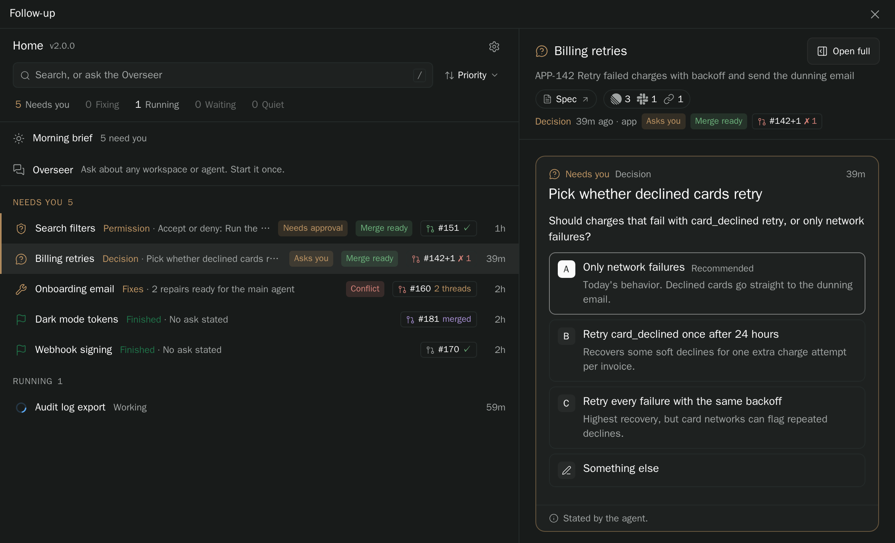
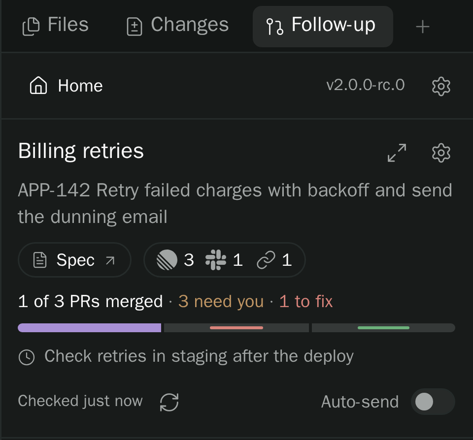

# Release notes

What changed in each version of Follow-up, newest first. Follow-up shows the curated part of a major release in "What's new" after the update, and every version's notes from Home's version line.

## 2.0.1 (2026-11-14)

Fixes are easier to follow, merging takes one click, and Follow-up runs much lighter.

- **Tasks:** what Follow-up finds on your PRs (conflicts, review comments, failing checks) is now a task with one clear state, and Tasks shows what goes to the agent next and when.
- **One-click merge,** and a No review setting per repository that lets agents merge their own PRs.
- **Answers:** add a note to your pick on a decision card, or put your answer straight into the agent's message box.
- **New:** Rename with AI, Report a bug from Settings or any error, and a card in the chat for each agent or workspace an agent creates.
- **Lighter:** about half the CPU and much less memory, and on Paseo 0.16 changes show up live instead of by polling.
- Plus many smaller fixes.

Full changelog since 2.0.0

### Home and Needs you

- Rename with AI: pick it from a workspace's menu (Home, the sidebar view, the panel's new More button) or ⌘K, and Follow-up suggests a short name from the Summary, PRs and linked items. Edit it or accept it; Undo puts the old name back.
- What Follow-up finds on your PRs (conflicts, review feedback, failing checks, restacks) are now ordinary tasks in the workspace's Tasks, each with its PR and one plain state: Queued, Sent, Needs you or Done.
- Needs you, Home and the chat pill say "tasks" everywhere, and the Send in Needs you names the agent and doesn't repeat the task list.
- Home remembers which groups you folded. Needs you always opens, so nothing waiting on you hides behind a fold.
- A pull request without reviewers asks once in Needs you, naming the suggested reviewer ("Add reviewers to … : Ravi"), instead of a second reviewers card beside it.
- Home's "Follow-up is fixing" is now "Sending": messages on their way to an agent, with when and why each goes out, and Send now where it would go through. A send that waits on you stays in Needs you.
- Every Needs you row about a PR opens it in one click: an Open #N link beside its action, and each #N it names is a link.
- Agents get each inbox row's PR links from inbox_list.
- A copied answer, or one put in the chat, stays in Needs you as "Your Q1 answer isn't sent yet" until it reaches the agent. Sending it from the chat, Send on that row (one click) or Sign off clears it. Before, Copy cleared it at once.
- On Paseo 0.16, the recovery agent runs in the background: no tab, no notification and no sidebar row. Its progress shows in the workspace panel.
- The "has no reviewers" row has a "Let the agent merge in" link that switches its repository to No review, with Undo.
- Switching a repository to No review clears its "Add reviewers" asks everywhere at once (Needs you, the header, the pill and Home); Undo brings them back.
- Search results look like the rows of your list, with the words you typed highlighted where they appear. A match in a branch, PR or linked issue shows on the second line.
- The Follow-up sidebar view has a filter and Home's sort. The sort is one setting for Home and the sidebar, the same on every device, and agents can change it when you ask.
- A task names the agent working on it and whether it is working, idle or closed, instead of a stale "Agent working", with Open agent. The status line and Home spin only while that agent really runs.
- An answer you copied or put in the agent's message box now reads "not sent yet" on the chat's card, in the question and in Activity, like Needs you, instead of "Answered" with a check. It reads Answered once it reaches the agent.
- In menus on a phone, the check beside the chosen sort and the action icons now sit centred beside their item, sized to match the text.
- An open question shows once in the panel and on Home, under one name: the agent's ask and its question are one card in Needs you, with other questions as headers below. Blocked tasks say what they wait on.
- Right-click a workspace in the sidebar view to open its menu.
- A task an agent marks blocked only asks you something when it is blocked on you, with a real question. Tasks waiting on a pull request or another agent show as Blocked in Tasks instead of in Needs you.
- On Paseo 0.16, Home, the sidebar and the pills update the moment something changes, on every device, instead of checking every 15 to 60 seconds. An open Follow-up now sends almost nothing while you aren't using it.
- Follow-up's worker makes less short-lived garbage under load: the workspace list re-serializes only the workspaces that changed, and the Needs-you inbox is saved at most once every 2 seconds.
- Needs you, the usage meters and a workspace's Summary answer at once instead of waiting on Paseo; what's new arrives on the next refresh.

### Questions and answers

- Decision cards: "Add note" under the options lets you send a pick with a note ("A, but keep the BOM off"). One tap still sends; with a note typed, each option reads "Send A with note".
- A note sent with a picked option on a decision card (by an agent's brief_action today) now reaches the agent and shows on the chat's answer card. Before, only Something else kept its words.
- You're asked only when the same problem was sent twice with no change, and the card says which one.
- When an agent creates another agent or a workspace, the chat shows a card for it: its name, model, live status and what Follow-up knows (an open question, PR state). Tap it to open the agent or workspace.
- Paseo 0.16: **Put in chat** on a question adds your answer to the end of the agent's message box to edit before sending. It never replaces a draft; if the chat can't open, the answer is copied. Copy becomes an icon (0.15 keeps its label).
- Follow-up stays quick on workspaces with hundreds of PRs or questions.
- A multi-decision card is titled with the agent's ask, not Q1.

### Repairs and PRs

- After a reload mid-send, Follow-up checks the agent's chat and sends the message again only if it never arrived.
- The top of Tasks says who the next message goes to, when it goes and why it waits, with Preview and Send now. You can keep any single task for yourself by turning its Auto-send off.
- A task that went out twice with no change on GitHub, even if the agent said it was done, asks you on its own, and everything else keeps going. This replaces the old rule that stopped a PR's messages after three tries.
- When the machine is short on memory, one line at the top of Sending says auto-sends are paused and why.
- What Follow-up sends the agent is called tasks everywhere, never repairs.
- The deploy check is now a per-repository setting on your machine, set by an agent. Settings → Following → PR workflow shows it for each repository, or Not set up.
- One click on Merge merges: no second "Merge this PR?". The button names everything it merges first ("Merge 3 PRs"), and a blocker found at click time merges nothing and says why.
- You can set a repository to No review in Settings → Shipping PRs. There, Follow-up never asks you to add reviewers or merge, and agents merge their own PRs once checks pass. Team review stays the default.
- Report a bug, an idea or feedback from Settings → General, Command-K or any error message. Your agent writes it up with versions and recent errors, removes private names, and shows you the issue before it goes to GitHub.
- When GitHub's API limit for your account runs out, pull requests keep their last known status instead of turning Unknown, and Follow-up waits for the limit to reset before asking again.
- An Add reviewers row says only what is new: "Suggested: Ravi" under its title, not the ask again. No headline repeats its label or the PR number its chip already shows.
- A merged PR reads by its title, not "#240 merged" beside its chip.
- Follow-up uses far less of your GitHub API limit: an agent finishing a turn rechecks only its own workspace's pull requests, and agents finishing together share one check.
- Follow-up's worker does less work when an agent's turn ends: it checks only that workspace, and a PR the agent just opened still shows right away.

### Providers and helper agents

- After a failed recovery, the Recovery block offers one action, Retry recovery, instead of both Run recovery and Retry recovery.

### Setup, Settings and updates

- On the phone, Follow-up now keeps your settings category and folded sections after you reopen the app.

### Performance

- Follow-up uses about half the CPU it did, reads about 50 times less from disk and opens one daemon connection at a time instead of one per workspace.
- Follow-up writes its state files only when something really changed, about 8 times less often.

### More

- An agent whose session Paseo closed (after an hour idle or a plugin reload) keeps its link as "Open chat" on task rows and cards. Only archived agents show words alone.
- No repository tracks by default from Follow-up itself anymore: with Follow every workspace off, only the projects you switch on are followed.
- Ask any agent to "report a bug about Follow-up" and it files a detailed issue only after you say yes. Screenshots are uploaded only if you agree for that report.
- Follow-up keeps one connection to Paseo instead of opening a new one for each read, and asks for usage meters only when Smart Session is installed.
- Follow-up reads each agent turn once, picking up where its last read stopped, instead of re-reading the newest part of the chat at the start of the turn, at its end and again for discovery.

### Fixes

- Fixes no longer ask you to Retry when the agent's turn ends without reporting back. Follow-up checks GitHub instead: what's cleared is done, and what's still open goes in the next message.
- Sending is lighter: each send writes only its own workspace and reuses the agent list, so a few sends no longer leave the worker ~110 MB larger, and it stays quiet afterwards (it used to keep making ~16 Paseo requests a minute).
- The line under queued fixes now says exactly why they haven't gone out, such as a PR Follow-up couldn't read or a send that was refused, and only says "sending now" when one is really going out.
- Fixes that keep changing no longer push their send back: they go out a minute after the first one was queued.
- A task whose agent Paseo no longer knows reads "Agent unavailable" instead of "In progress", and archived agents keep reading "archived" after Follow-up re-reads Paseo's list.
- A "No ask stated" card no longer sits above a Needs-you item that says what to do.
- A PR the agent merges itself no longer reads "No reviewers" in the Pull requests card or the PR sheet.
- Follow-up pauses only when you stop the main agent. A turn replaced by a new message, a compaction or a session reload no longer leaves it paused, and any pause lifts once the agent runs again.
- Follow-up reads GitHub inside its own process, so starting up or finishing a deploy no longer launches dozens of `gh` processes.
- A "Nothing needed" turn end no longer shows in Needs you or counts there when the workspace is flagged for something else, like a merged PR. The pill and rows read that reason instead.
- Follow-up uses much less memory while your agents are busy, and no longer reconnects to Paseo every few seconds.
- Needs you: a merged PR reads "Merged", not "PR closed", which now means closed without merging. A PR the agent merged itself no longer flags you; a Later "until this PR merges" still wakes.
- An agent that says nothing is needed no longer stays in Needs you with an older "No ask stated" card.
- A PR that merged long ago no longer shows up in Needs you again as "Merged" in workspaces with many PRs.
- The popup no longer repeats its ask or to-do count.
- A row never says "No ask stated" above work to do.
- Merged pull requests no longer show Unknown after GitHub was briefly unreachable or out of API budget. Every pull request keeps its last known status, and its details say when it was last checked.
- Tracking a workspace right after creating its agent no longer fails with "This workspace has no available main agent".
- Follow-up uses much less memory and CPU with many workspaces, and no longer spikes when it starts.
- Signing off, Later and Undo no longer wait for Paseo to clear the unread dot.

## 2.0.0 (2026-11-11)

Follow-up keeps track of every workspace your coding agents work in, until the work is merged and done. It shows you in one place which agents are waiting on you and why, sends failed checks and review comments back to the right agent by itself, and lets you answer an agent's question without opening its chat.

### One list of what needs you

Home lists every workspace, grouped by what it needs from you. When an agent finishes, asks something, hits an error or waits for a permission, it moves to the top, under Needs you, and stays there until you mark it done or reply. You act on it right there, without switching to its chat.

### A panel on every workspace

The Follow-up tab beside a workspace's chat shows how far its PRs are, what needs you and what's left to fix, with a bar for the PR stack, what the agent is doing now and the question it's waiting on.

### Answer questions from anywhere

When an agent needs a decision, it asks in a card with lettered options, its recommendation and room for your own answer. Answer it on Home, in the panel, in the bar above the agent's message box, or on your phone. The answer goes straight into the agent's chat.

### Fixes go back to the agent

When a PR's checks fail, it hits a merge conflict or a reviewer leaves comments, Follow-up sends them to the agent that made the PR, in one message once it's idle. You're only asked for what's yours to decide, like merging. Works with plain GitHub; Graphite is optional.

### Context at a glance

Each workspace gets a one-line description of what it's for, and a list of the Linear issues, Slack threads and docs it's about. Ask about any workspace from Home's search box, and an agent that knows all of them passes your question to the one doing the work.

### Fits your setup

- Its small background jobs, like writing those descriptions, run on any model provider Paseo has.
- Agents can do anything you can click in Follow-up, after showing you a plan.
- It updates itself when nothing is busy, and rolls back if an update fails.

---

Follow-up borrows ideas from [Progress](https://github.com/stevecastaneda/paseo-plugins/tree/main/progress) by Steve Castaneda and [Better Paseo](https://github.com/RoundRedDot/better-paseo) by RoundRedDot. Thank you to both.

Full changelog since 1.0.1

### Home and Needs you

- Home: every workspace in one list, grouped by what it needs from you, with a detail pane to answer, merge or sign off without leaving it.
- Needs you: an agent lands there when its turn ends, it asks something, it errors or it waits on a permission, and stays until you sign it off or write to it, from any device.
- A pill above the composer leads with the one thing that needs you in that chat, and the sidebar's Follow-up item counts the agents that need you.
- Home's search matches workspace names, branches, PR numbers and titles, and linked issue keys. Sort orders each group by priority, recency, age or name.
- Right-click a workspace on Home, or long-press it on a phone, for quick actions: Later, Sign off, answer its question, send repairs, copy the branch or PR link, and more.
- Later puts a workspace off until a time you pick, shows when it comes back, and has Undo and Bring back now. An agent's "tonight" or "tomorrow" means your timezone.
- Repairs queued for an idle agent show in Needs you with a Send button, and a workspace with everything in but no Done shows Ready to finish.
- An action card has a Done button that tells the agent you did it. Done shows as in progress while you can still undo it.
- Ctrl+Z (Cmd+Z on a Mac) undoes the last action while its Undo message shows, on any keyboard layout.
- You can select and copy text in cards, the panel, Home, sheets and messages.
- Follow-up's version shows at the top of Home and the panel. Tap it for update status and the release notes.

### Questions and answers

- When an agent needs you, a card at the end of its chat says the ask in one line, with decisions as buttons and only the context you need.
- Every question with options ends with Something else, for your own answer. Questions with several decisions let you pick every answer, then send them in one message.
- Your answer is recorded at once. The card shows Sending until the agent has it, offers Send again if it couldn't be delivered, and never sends it twice.
- Press Cmd+Enter (Ctrl+Enter) to send an answer or save a dialog, even while typing a note.
- Links in questions, cards, tasks and agent replies are clickable, including PR references like owner/repo#123.
- An answered question stays on its card, folded to what was asked and what you picked, and a card answered somewhere else or replaced by a newer one says so.
- Question and option text is shown whole; long context opens in full with Show more.

### Repairs and PRs

- Follow every workspace and Send repairs automatically are on by default, also after upgrading from 1.x. On a fresh install, auto-send waits until you finish or skip setup. Turn Follow every workspace off in Settings → Following.
- Works with plain GitHub; Graphite is optional, chosen per repository. Settings → Following → Shipping PRs sets how each repository ships PRs.
- On plain GitHub, the PR sheet follows GitHub's own review and check verdict.
- Reviewers per repository, plus a default list, for Add reviewers.
- A deploy Follow-up has seen stays counted until a rollback, and Done goes through with a note when Follow-up can't check what production serves.
- Saving a spec link, a task's schedule or a reviewer pick closes at once and confirms with a short message.
- An agent can mark a PR it merges itself, so Follow-up stops asking you to review or merge it. Work the agent is waiting on reads as Waiting, with what it waits on.
- Follow-up checks GitHub with far fewer requests and no helper processes, and checks a workspace's PRs as soon as you open it.

### Agents and the main agent

- Agents can do everything you can click in Follow-up, including its settings, setup and priorities. Changes show a plan first.
- An agent can take over as a workspace's main agent when the main one is gone or idle, or when you ask. The panel names the main agent and shows a change for a day, with Undo.
- When an agent answers or acts for you, Follow-up records that agent, not you, and the card says whose answer it was.
- Trust bypass: pick agents whose permission prompts Follow-up approves for you, with secrets masked in what it approved.
- Claude agents keep working while a long command runs, instead of ending their turn to wait. This replaces the separate Wait plugin. Jobs stop after 3 hours unless the agent asks for longer.
- On Paseo 0.16, agents leave long commands to Paseo, an agent with a command still running counts as running, and other plugins' background helpers are left alone.
- Follow-up's routine tool calls stay inside Paseo's grouped rows; only a question asked and Workspace done stand out in the chat.

### The Overseer and AI priority

- The Overseer: one agent you talk to about all your workspaces. Ask it from Home's search box or ⌘K, and it passes your ask to the agent that owns the work. What it forwards starts "From the developer via Overseer:".
- AI priority orders Home from your Linear issues, Slack DMs and mentions and GitHub review requests, with a one-line reason for each workspace. Re-rank now answers at once, and rankings stay steady when nothing changed.

### Summary and Linked items

- Summary: one short sentence under each workspace's name saying what it's for. Rewrite it from the panel.
- Linked items: the Linear issues, Slack threads, docs and artifacts each workspace is about, next to its Spec with a count for each. Open the list to see who linked each one and why, add one by pasting a link or key, or remove one with Undo.
- Agents link what they start from, and Follow-up picks links up from your messages and the agent's lookups. A Linear key counts only once Linear confirms it.

### Helper agents and providers

- Settings → Agents sets the provider, model and effort for Summaries, the Overseer, recovery and AI priority, and recommends a model from what you have, with Use recommended.
- Summaries and AI priority run on any provider Paseo has. Other providers run each job as a short hidden agent.

### Setup, Settings and updates

- Follow-up moves itself to its new plugin id, follow-up, once while nothing is busy, keeping your workspaces and settings. It needs Paseo 0.15 or later.
- Getting started: a short first-run setup that checks GitHub and the helper agents, shows what Follow-up does on its own, and sets your defaults.
- Settings has five categories: General, Following, Reviewers, Agents and Inbox & display. Tabs on desktop, a list you tap into on a phone.
- Follow-up updates itself: Install automatically, Tell me or Off, on the Stable or Beta channel. It installs only when no agent is busy and goes back to the old version if the new one fails.
- What's new pops up only after a major update, once per device.
- With reduced motion on, setup's steps show at once.
- Installed from Paseo's plugin list? Follow-up moves to its new plugin id by itself there too, keeping your workspaces and settings.
- What's new shows screenshots of what it describes.
- Release notes and What's new open wider on large screens, so their screenshots are easier to read.
- The release notes always show their scrollbar when there is more to read, and their titles name Follow-up.

### Phone and performance

- Reworked for phones: Home, the cards, the composer pill and Settings fit a phone screen, with real tap targets.
- Far less load on Paseo: one shared list of agents and workspaces instead of asking for them every few seconds, and no polling while the app is hidden.
- On Paseo 0.15 and later, agents get Follow-up's tools through Paseo itself, so no extra process starts per agent. The old per-session registration is removed, with a backup of each file it touched.
- After an update, agents in the middle of a turn keep using Follow-up's tools instead of hitting "tool not found".

### Fixes

- Home, the panel and the header agree on what Follow-up is doing, and "Follow-up is fixing" shows only while repairs are really with the agent.
- A question an agent asks again no longer shows up twice.
- A workspace whose agent is still working no longer shows in Needs you.
- A card in the chat closes only when you answer it, not on another agent's message, a Follow-up prompt or a schedule.
- A card shows a PR's checks and reviews only when it's about that PR.
- Recent steps label other agents' messages and Follow-up's own, and never report Follow-up's bookkeeping as the agent's work.
- In a workspace with several agents, each row shows only its own reason and error.
- An agent that failed a turn and kept running no longer shows Error, and Follow-up resumes on its own unless you stopped it.
- Review requests are found reliably, and an account that fails to load no longer reads as "no review requests".
- Trusted agents no longer wait on permission prompts that were already showing when Follow-up started.
- An answer card shows your whole answer and note.
- If your Claude or Codex settings file is a link, Follow-up updates the file it points to and keeps the link.
- Error messages are as short as Paseo's own, with the full reason where Open takes you.
- A workspace no longer shows Needs you for "Add reviewers" in a repository nobody is set up to review, and the flag goes away on its own once the PR merges or gets reviewers.
- A failed update no longer shows as failed once a newer version of Follow-up is running.

### More

- Tapping a screenshot in the notes shows it larger inside Paseo instead of opening a browser tab.

