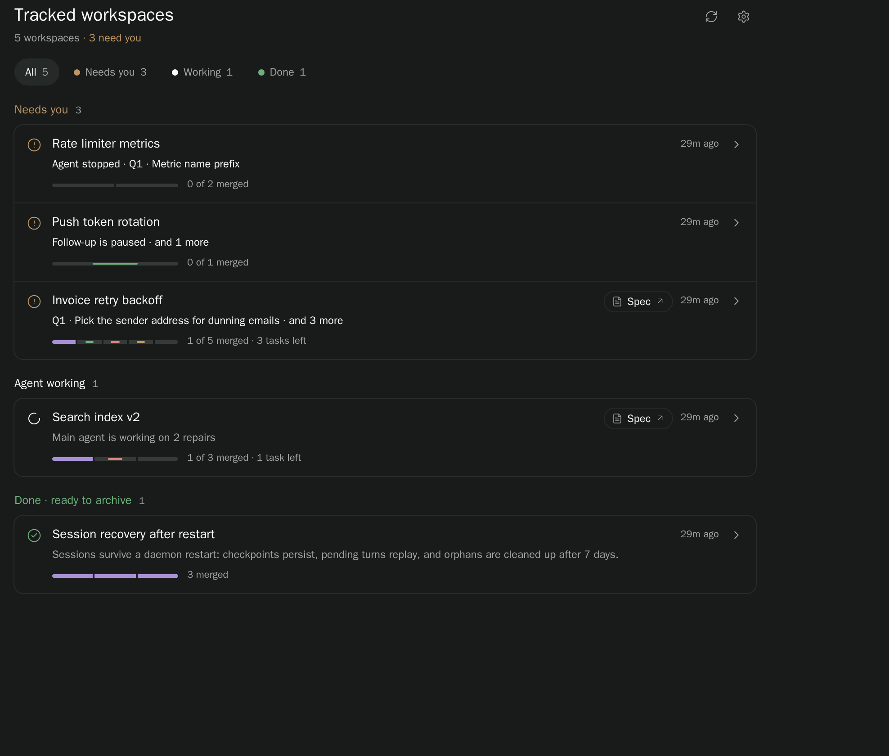

# paseo-follow-up

[](https://www.npmjs.com/package/paseo-follow-up)
[](https://www.npmjs.com/package/paseo-follow-up)
[](https://paseo.sh)
[](LICENSE)

Follow-up watches every pull request a Paseo workspace opens until the work is actually done. It shows the whole stack at a glance, gathers conflicts, failing checks and review threads into one repair batch for the workspace's main agent, and tells you when something needs you: an approved PR to merge, a question the agent asked, or a batch to send. Answer a question in Follow-up and the answer goes straight to the agent's chat.

<picture>
  <source media="(prefers-color-scheme: light)" srcset="docs/media/follow-up-hero-light.png">
  
</picture>

Screenshots use synthetic workspaces and PRs.

## Install

```sh
paseo plugin install paseo-follow-up
```

Needs Node 22+ and an authenticated GitHub CLI (`gh`) on the daemon host. Merge buttons use your saved Graphite CLI authentication. The installed plugin ID stays `follow-through`, so existing settings and tracked work carry over.

## Use

Open a workspace, click the Follow-up icon in its header (or press ⌘K / Ctrl+K and choose **Follow-up: open for this workspace**), then **Track this workspace**. To track every workspace in a project, open the settings (the gear in the panel, or **Follow-up: project settings** in ⌘K) and turn the project on.

The panel reads top to bottom:

- **Status.** How many PRs have merged, how many things need you, how many PRs need fixing, and a bar with one segment per PR in merge order. Below it, what the agent is doing right now.
- **Needs you.** One row per decision, each with its button: answer the agent's question, send repairs to the main agent, merge an approved PR, resume after you stopped the agent, or retry a batch that didn't finish.
- **Pull requests.** Each stack drawn top to base, the way Graphite shows it, with merged PRs folded away.
- **Tasks.** Work that outlives a merge, such as a production check or a backfill. Tasks wait for you unless you schedule them for after a merge or deploy.
- **Activity.** What happened and how long it took: repairs sent and finished, merges, merge and reviewer actions, and every question under its ref.

The **Spec** chip in the header opens the page that sums up the workspace, usually the Claude artifact the main agent keeps up to date. The agent registers it with a tool call, Follow-up also picks up artifacts the workspace's sessions publish, and you can set, change or remove it under **Spec, agent and recovery**. Your link wins over the agent's, which wins over detection.


### Questions

When the main agent needs a decision it asks in Follow-up instead of burying it in chat. Each question gets a permanent ref (Q1, Q2…), lettered options with what each means, the agent's recommendation, and a line saying what the agent does while it waits. Pick an option, add a note if you like, and **Send to agent**: the answer goes straight into its chat, even mid-turn, and stays recorded under its ref. **Copy** puts the same answer on the clipboard instead. If the agent can't take it yet (Session Guard paused it, or a permission prompt is open) the answer waits and goes out on the next check; if Paseo doesn't confirm the message, Follow-up asks you to check before resending. A task the agent marks blocked becomes a question too.


The question mode in Follow-up's settings tells agents what to do until you answer: **Stop** (end the turn and wait), **Work around** (the default: build nothing the answer affects, keep working on the rest) or **Keep building** (build the recommendation and change course if you pick another). Big questions, ones that reach outside this computer or that most of the work depends on, always wait.

### Everywhere else

When a workspace needs you, a pill appears above its main agent's message box with the same actions. It steps through open questions ("Question 1 of 2") so you can answer without leaving the chat. The sidebar's Follow-up row counts how many workspaces are waiting, and nothing shows when nothing needs you.


Tap a PR, or its segment in the bar, for a sheet with its checks, reviewers and Merge controls. When Merge isn't available yet, the sheet says what it is waiting for.


The expand icon next to the gear (or **Follow-up: open the larger view** in ⌘K) opens the workspace as a full screen, in two columns when there is room: what needs you on the left, the stacks and activity on the right. Esc or the collapse icon takes you back.


In the agent's chat, Follow-up's own tool calls collapse into one-line rows, your answers and repair batches show as short cards instead of raw prompts, and the agent's Done call gets a card of its own.


**Follow-up: all tracked workspaces** (or the sidebar row) lists every tracked workspace, grouped by who's up next, with each stack's bar and its Spec link.



On a phone the panel opens as a tab, and the PR sheet and pill popover open as bottom sheets.


## Needs-you inbox (beta)

The 1.1 beta adds an inbox for your agents. An agent lands in **Needs you** when its turn ends, when it asks a permission or question, when it errors, when Session Guard pauses it and needs a decision, or when Follow-up sees its PR's checks fail, new review threads, or the PR merge. It stays there until you **sign it off** or **write to it yourself**, from any device. Opening it, reading it and Paseo marking it read change nothing.

- **Sign off**: the ✓ on a row, the pill above the composer (it shows the reason and how long the agent has waited; **More** has *Sign off & next*, *Later…*, *Mute this turn* and *Don't flag finishes*), `/ok` in the composer (`/ok next` opens the next one), or ⌘K → `ok` → **Sign off & next**. Every sign-off can be undone for 24 hours.
- **Needs you N** in Paseo's sidebar header opens the inbox on Follow-up's screen. It shows only while something needs you, unless you turn on *Show the sidebar item at zero*.
- **Messages from automation don't count as yours**: agent-to-agent messages, Follow-up's own repairs, Defer, Smart Session and Session Guard continuations, and schedules leave the flag in place. Their turn end flags as usual. A script calling `paseo send` without an agent envelope counts as you until Paseo reports who sent a message.
- **Don't flag finishes** (per agent, in the row's ⋯ or the composer's **More**): for agents that run on a schedule, such as a plugin auto-update. Permission prompts and errors still flag.
- **First run** imports what Paseo marks unread and idle agents from the last 7 days you never replied to. Older idle agents wait in a one-time *Unsorted* list with a confirmed *Sign off all* that one Undo reverses.
- On Paseo builds with sidebar views (Paseo `main` after 2026-11-07, expected in the next release), **Settings > Sidebar > Sidebar view > Follow-up: Needs you** puts the inbox in the sidebar, with your workspace list folded below it.
- Turn the whole inbox off in **Follow-up: display settings** (⌘K). Off means nothing is flagged and no pill or sidebar item is shown.

### What you need to do, front and center (1.2 beta)

When an agent needs you, Follow-up adds a **brief** at the end of its chat, right above the composer, so it's the first thing you see when you open the agent:

- **The ask in one line**, written as what you do: *Pick how the export API is rate-limited*, *Review and merge #813*, *Allow or deny: run the migration on staging*, or *Nothing needed. Daily updates are scheduled.* The same line shows on the inbox row and in the pill's tooltip, and the pill's label comes from it (*Asks*, *Merge*, *Error*, *Paused*, *Finished*).
- **Decisions as option rows.** Click one and it goes to the agent as your message, which clears the flag. Typing the letter or the option's label in the composer counts too. On a phone, or a window too short for the whole card, each option shows its letter and label, with what it means one tap away, so the card fits above the composer.
- **Only the context needed**, plus PR facts Follow-up already knows, and the one move for this kind of ask: *Squash & merge* (Follow-up's merge flow), *Retry the turn*, *Copy error* or *Sign off & next*. Permission briefs are a single line: Paseo's own prompt right below is the control.
- **Where it came from**, always: stated by the agent, from the permission request, Session Guard, the failed turn or Follow-up's PR state. If the agent stated nothing, the card says so and points at its last paragraph. It never guesses an ask.

The content comes from a new `needs_you` tool that every root agent gets while the inbox is on, with an instruction to call it once at the end of a turn. Contributors, recovery agents and subagents don't get it. After you answer, sign off or the agent keeps going, the card folds to one muted line, so the history still shows what was asked and what happened.

**Ask agents to state what they need** (on by default, in **Follow-up: display settings**): when a Claude Code root agent ends a turn without calling `needs_you`, Follow-up's Stop hook asks it once to call it, then lets it stop. It never asks twice in one turn, and skips subagents, contributors, recovery agents and agents waiting on a permission prompt. Codex and other providers get the instruction only. The settings screen shows how often agents stated what they need over the last 7 days.

Install the beta:

```sh
paseo plugin update follow-through --version 1.2.0-beta.0
# or, for a fresh install:
paseo plugin install npm:paseo-follow-up@beta
```

Go back to the stable release (the inbox file stays on disk and is ignored by 1.0.1):

```sh
paseo plugin update follow-through --version 1.0.1
```

Betas publish to npm's `beta` dist-tag, so `paseo plugin update` without `--version`, and scheduled updates that follow `latest`, never pick one up.

## How it works

- The workspace's main agent owns its PRs, tasks, questions, the spec link and the Done call. Other agents in the workspace can register PRs and check status.
- **Auto-send** is off for every newly tracked workspace, so each repair batch waits for your click. Turn it on per workspace and Follow-up sends batches itself once the agent is idle, after fresh permission and Session Guard checks.
- Follow-up never merges, turns on merge when ready, requests reviewers or archives on its own. **Merge** re-checks the stack, lists any PRs underneath that would merge first, and asks again.
- A merged PR is not the end: tasks such as production checks and open questions keep the workspace open until the main agent declares Done and everything has settled.
- Answers go out only when you click Send. Follow-up never answers for you.

## Send to Paseo and Graphite

With [Send to Paseo](https://github.com/tomgrin10/send-to-paseo) on the same daemon, its composer picks the agent that registered the PR. With Send to Paseo 2.2+, Follow-up can also toggle Graphite's **Merge when ready** through your existing pairing, while Graphite is open and signed in. Each change is confirmed in Chrome, which can remember the permission per repository. See the [integration and security contract](https://github.com/tomgrin10/send-to-paseo/blob/main/docs/follow-up-integration.md).

## Data and access

Paseo plugins run trusted, unsandboxed code on the daemon host. Follow-up reads workspace metadata, agent history and GitHub PR status with your existing credentials, and keeps its state in `$PASEO_HOME/plugin-data/follow-through`. It registers scoped MCP tools and reversible provider hooks only for tracked sessions. GitHub and Graphite writes happen only after an explicit click and a fresh eligibility check.

## Development

```sh
npm ci
npm run verify
npm run test:install
paseo plugin reload follow-through   # after changes
```

Integration checks use a separate Paseo home with synthetic agents. Version tags (`vX.Y.Z`) publish to npm through Trusted Publishing.

## License

[MIT](LICENSE) © 2026 Tom Gringauz.

Questions, question modes and the activity log are adapted from [Progress](https://github.com/stevecastaneda/paseo-plugins/tree/main/progress) by Steve Castaneda (MIT). Its notice is in [THIRD_PARTY_NOTICES.md](THIRD_PARTY_NOTICES.md).

## Other plugins

- [Defer](https://github.com/tomgrin10/paseo-defer) — Schedule messages for later delivery.
- [Send to Paseo](https://github.com/tomgrin10/send-to-paseo) — Send GitHub and Graphite PRs to Paseo from Chrome.
- [Session Guard](https://github.com/tomgrin10/paseo-session-guard) — Pause at session limits and continue after reset.
- [Smart Session](https://github.com/tomgrin10/paseo-smart-session) — Context compaction and usage insights.
- [Transcript Search](https://github.com/tomgrin10/paseo-transcript-search) — Search conversations across connected hosts.
- [Transfer](https://github.com/tomgrin10/paseo-transfer) — Copy or move workspaces between hosts.
- [Vitals](https://github.com/tomgrin10/paseo-vitals) — Host, process, agent and Docker monitoring.
- [Workspace Switcher](https://github.com/tomgrin10/paseo-switcher) — Arc-style Ctrl+Tab between recent workspaces.
