# paseo-follow-up

[](https://www.npmjs.com/package/paseo-follow-up)
[](https://www.npmjs.com/package/paseo-follow-up)
[](https://paseo.sh)
[](LICENSE)

Follow-up watches every pull request a Paseo workspace opens until the work is actually done. It shows the whole stack at a glance, gathers conflicts, failing checks and review threads into one repair batch for the workspace's main agent, and tells you when something needs you: an approved PR to merge, a question the agent asked, or a batch to send. Answer a question in Follow-up and the answer goes straight to the agent's chat.

<picture>
  <source media="(prefers-color-scheme: light)" srcset="docs/media/follow-up-hero-light.png">
  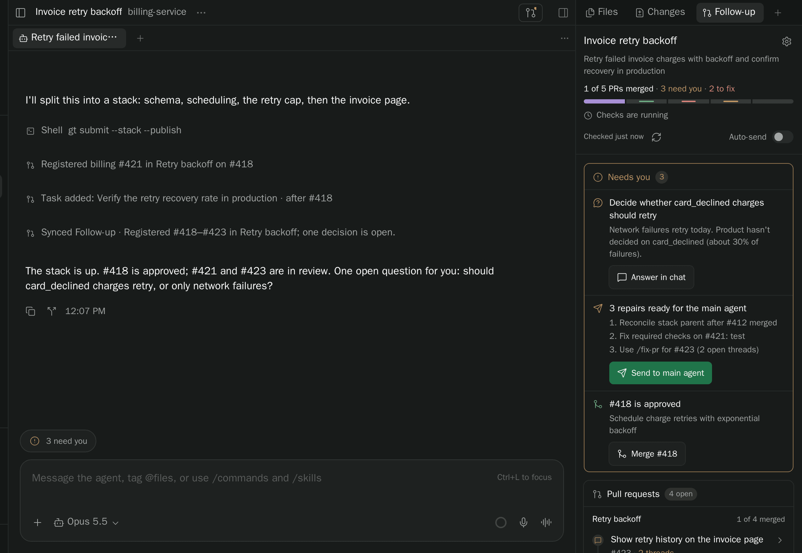
</picture>

Screenshots use synthetic workspaces and PRs.

## Install

```sh
paseo plugin install paseo-follow-up
```

Needs Node 22+ and an authenticated GitHub CLI (`gh`) on the daemon host. The installed plugin ID stays `follow-through`, so existing settings and tracked work carry over.

## Getting started

The first time you open Follow-up from the sidebar, a short setup takes Home's place. It takes about two minutes, and **Skip setup** leaves it at any point.

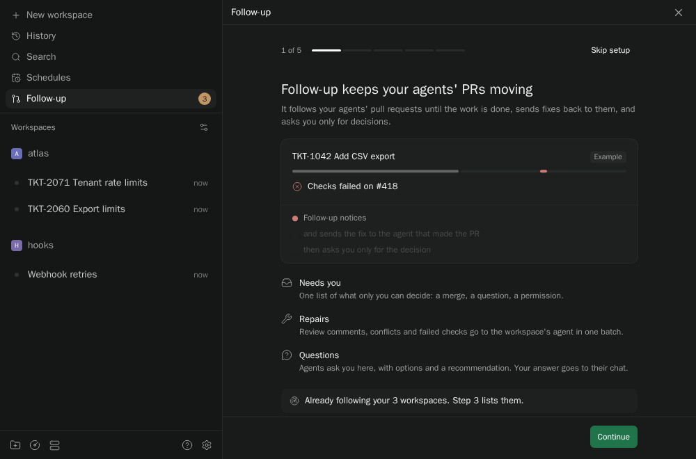

1. **What it is.** A worked example of one PR going from failed checks, to a repair sent to its agent, to a merge only you can approve, and how many of your workspaces Follow-up already follows.
2. **Check your setup.** Whether the GitHub CLI is signed in (and as whom), whether Claude and Codex are available for the helper agents, and whether agents get Follow-up's tools. Anything missing shows the fix, with the command to copy. Checks run only while this step is open.
3. **What Follow-up does without asking.** Follow every workspace (or turn single ones off), Send repairs automatically, and Trust bypass agents. They are on by default and save as you change them.
4. **Reviewers.** Who **Add reviewers** asks: a default for every repository, and a list per repository Follow-up has seen. **Skip, set later** leaves it empty.
5. **Updates.** Install automatically (recommended), Tell me, or Off, and the Stable or Beta channel. Passing the step or skipping setup keeps Install automatically.
6. **Helpers.** The Overseer and AI priority switches, which models they use (change them under Settings → Agents), and where Home, the workspace panel, Needs you and the Summary live.

Every switch in setup is the same one Settings shows, so nothing is applied twice and nothing is lost if you stop halfway. Setup remembers its step, so a reload or another device picks up where you left off. Run it again any time from **Set up Follow-up again** in Settings → **General**, the first category, or ⌘K → **Follow-up: Set up again**. If Follow-up was already installed before this version, it doesn't open on its own: Home shows one dismissible line offering it, for a day.

## What's new

After a major update (1.x to 2.0), the next time you open Paseo it shows **What's new**: the notes for every version since that device last looked, newest open, older ones folded. It shows once per device per version (once per host in the phone app), never on a fresh install and never over setup. Betas, minor and patch updates never pop it up. Betas have no notes of their own; their changes are collected in the next stable release. Home's last line says which version you run, with **Release notes** for the full list; for three days after an update to a version with its own notes it reads **Updated to X · What's new** instead. The notes ship inside the package as [CHANGELOG.md](CHANGELOG.md), so they work offline and match the installed version.

## Updates

Follow-up can update itself. **Settings → General** has three modes:

- **Install automatically** installs a new version at a quiet moment: no agent mid-turn and none of Follow-up's own work running, for five minutes in a row (after a day of waiting, any idle moment). Installing reloads Follow-up, which detaches its tools from open agent sessions until they reopen, so it never installs mid-turn.
- **Tell me** shows the new version in Settings → General, and as one line on Home only for a new major version (2.0). You choose when with **Install now**. It is the default on hosts that had Follow-up before updates existed.
- **Off** never asks npm on its own, not even when Settings opens. **Check now** still works.

Follow-up asks npm about once every six hours (one small request, nothing when unchanged), opening Settings → General checks at most once a minute, and **Check now** always asks. **Channel** picks Stable (`latest`) or Beta; it starts on Beta when you run a beta, and never offers a stable older than what you run.

Before installing a version on its own, Follow-up reads the version's npm provenance and checks that it was built by this repository's GitHub workflow and is the exact file npm serves. That file's checksum is then pinned for the install. Follow-up does not verify the provenance signature itself, so this guards against a version published by hand or from another repository, not against a compromised registry. A version that fails the check is never installed from Settings; install it by hand with `paseo plugin update follow-through --version <version>` only if you trust it.

An installer runs alongside Follow-up for the install and the ten minutes after it. If the new version fails to load, reports an error, or doesn't start within two minutes, it installs the previous version again, and Settings and Home say what happened. Follow-up doesn't retry a rolled-back version on its own. Every update is listed under **Update history**. Installs from a Git checkout or a local folder are left alone: pull and rebuild to update.

Agents can do the same with `updates_status`, `check_updates`, `set_updates` and `install_update` (the last two as confirmed plans).

## Use

Follow-up follows every workspace as soon as it has an agent; there is nothing to turn on. Open a workspace and click the Follow-up icon in its header (or press ⌘K / Ctrl+K and choose **Follow-up: open for this workspace**) to see that workspace's panel. Its **Home** button opens Home, the list of every workspace. To leave a workspace or a project out, open the settings (**Follow-up: settings** in ⌘K): **Following** has the global switches, **Workspace exceptions** the per-workspace ones.

The panel shows this workspace only, top to bottom: a **Home** button, the main agent's open ask (its brief, with the decision options and **Sign off**), then:

- **Status.** How many PRs have merged, how many things need you, how many PRs need fixing, and a bar with one segment per PR in merge order. Below it, what the agent is doing right now.
- **Needs you.** One row per decision, each with its button: answer the agent's question, send repairs to the main agent, merge an approved PR, resume after you stopped the agent, or retry a batch that didn't finish.
- **Pull requests.** Each stack drawn top to base, with merged PRs folded away.
- **Tasks.** Work that outlives a merge, such as a production check or a backfill. Tasks wait for you unless you schedule them for after a merge or deploy.
- **Activity.** What happened and how long it took: repairs sent and finished, merges, merge and reviewer actions, and every question under its ref.

The **Spec** chip in the header opens the page that sums up the workspace, usually the Claude artifact the main agent keeps up to date. The agent registers it with a tool call, Follow-up also picks up artifacts the workspace's sessions publish, and you can set, change or remove it under **Spec, agent and recovery**. Your link wins over the agent's, which wins over detection.

## Works with GitHub; Graphite optional

Follow-up works with plain GitHub out of the box: readiness comes from GitHub itself (its merge state, required checks, reviews, unresolved threads, branch protection and rulesets, and the merge queue if the repository has one), **Merge** runs `gh pr merge` with a merge method the repository allows, and **Auto-merge** is GitHub's own auto-merge. Stacks are chains of base branches: a PR whose base is another PR's branch sits on top of it, a stack merges bottom to top, and after a parent merges Follow-up retargets the child to trunk with `gh pr edit --base` if GitHub didn't already.

If you use [Graphite](https://graphite.dev), Follow-up picks it up per repository: **Auto** chooses Graphite where the `gt` CLI is on the daemon's PATH, signed in, and the repository was set up with `gt init`; everywhere else it's GitHub. Detection only looks at files (it never runs `gt`) and is cached for ten minutes. In Graphite repositories, Merge goes through Graphite with your saved CLI sign-in, and Merge when ready works through the Send to Paseo companion (below).

Auto is the default for every repository, and setup's **How do you ship PRs?** step shows what it picked. To change it later, open Follow-up's settings (the gear on Home or in a workspace's panel) → **Following** → **Shipping PRs**: a default for every repository (Auto, Graphite or GitHub), an override per repository showing what Auto picked and why, the merge method, and how agents should address review comments: Follow-up's built-in steps (read the unresolved threads with `gh`, fix, push, reply and resolve) or a skill or command of your own, such as `/fix-pr`. Agents get instructions for the workflow their workspace uses, so a GitHub workspace never hears about Graphite. An install that already had a `/fix-pr` command or skill in `~/.claude` keeps using it.

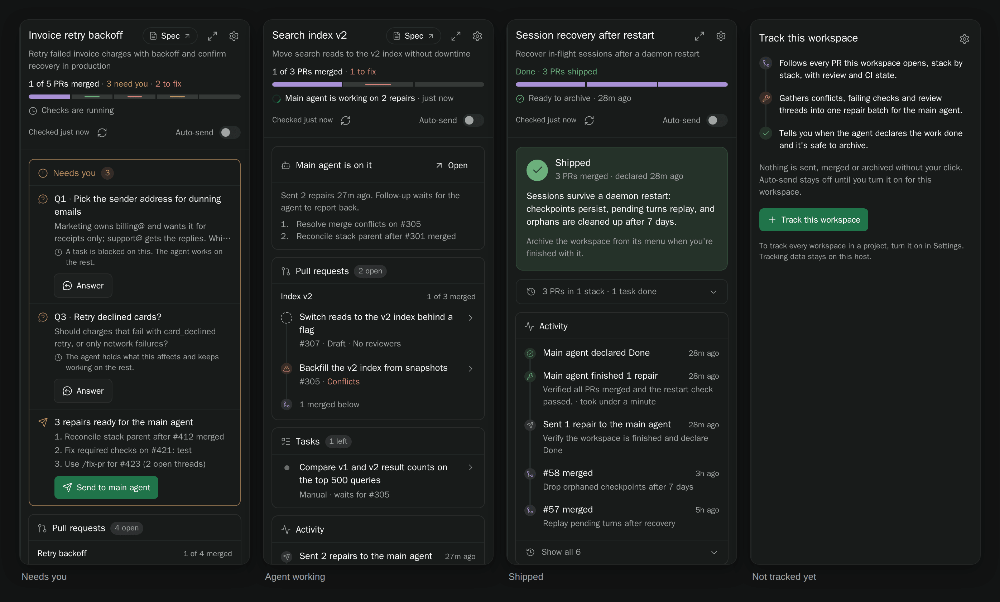

### Questions

When the main agent needs a decision it asks in Follow-up instead of burying it in chat. Each question gets a permanent ref (Q1, Q2…), lettered options with what each means, the agent's recommendation, and a line saying what the agent does while it waits. Pick an option, add a note if you like, and **Send to agent**: the answer goes straight into its chat, even mid-turn, and stays recorded under its ref. **Copy** puts the same answer on the clipboard instead. If the agent can't take it yet (Session Guard paused it, or a permission prompt is open) the answer waits and goes out on the next check; if Paseo doesn't confirm the message, Follow-up asks you to check before resending. A task the agent marks blocked becomes a question too.

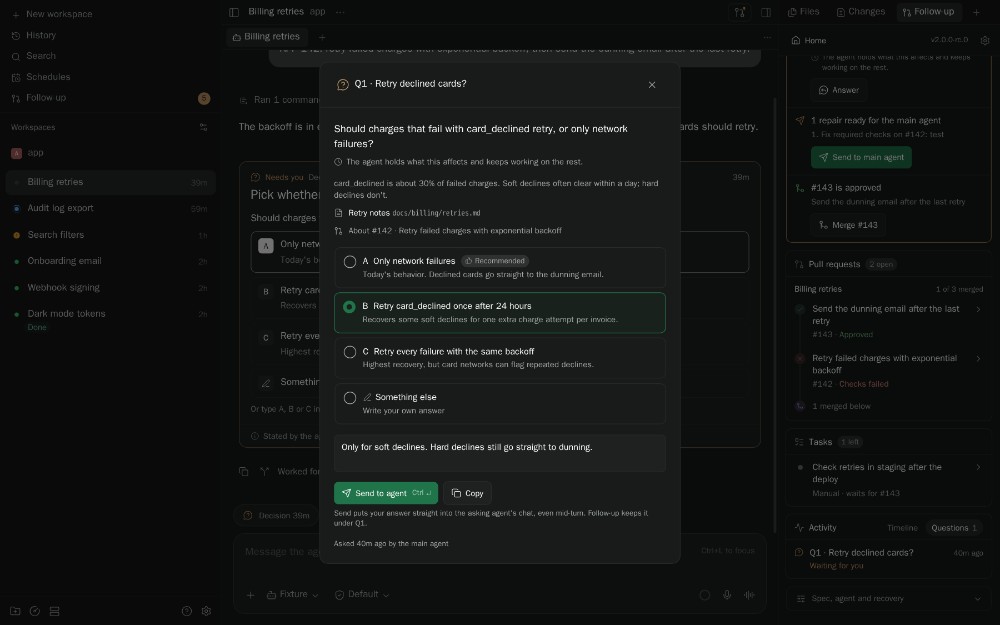

The question mode in Follow-up's settings tells agents what to do until you answer: **Stop** (end the turn and wait), **Work around** (the default: build nothing the answer affects, keep working on the rest) or **Keep building** (build the recommendation and change course if you pick another). Big questions, ones that reach outside this computer or that most of the work depends on, always wait.

### Everywhere else

When a workspace needs you, a pill appears above its main agent's message box with the same actions. It steps through open questions ("Question 1 of 2") so you can answer without leaving the chat. The sidebar's Follow-up row counts how many workspaces are waiting, and nothing shows when nothing needs you.

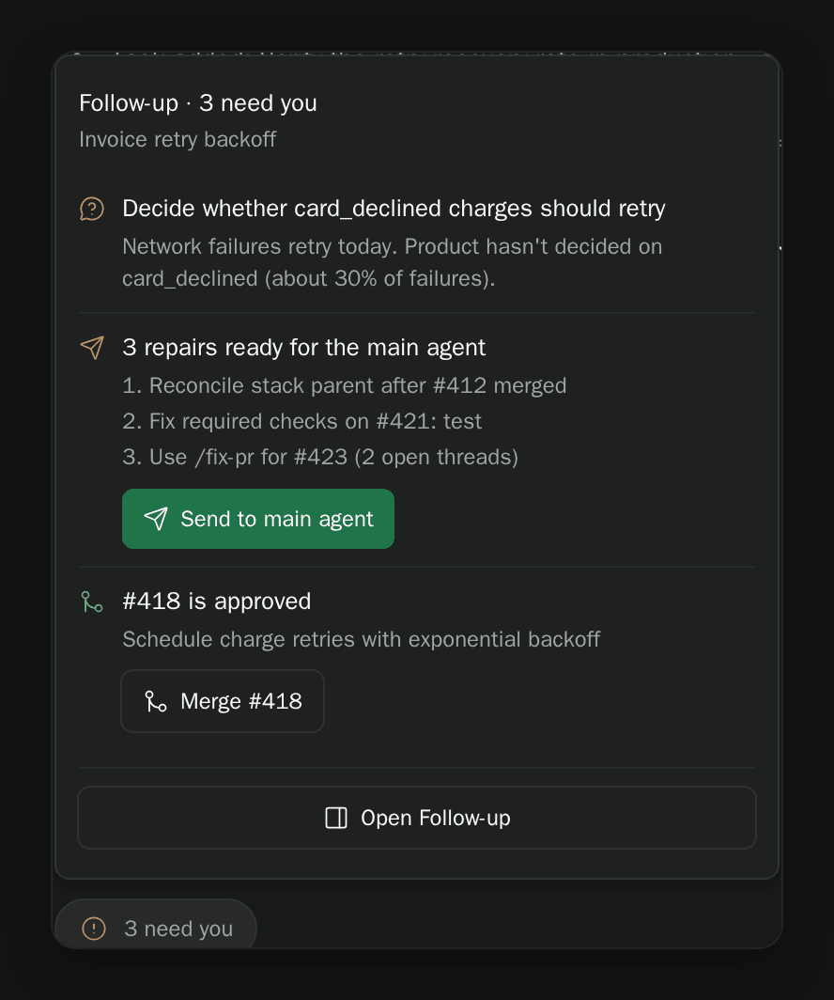

Tap a PR, or its segment in the bar, for a sheet with its checks, reviewers and Merge controls. When Merge isn't available yet, the sheet says what it is waiting for.

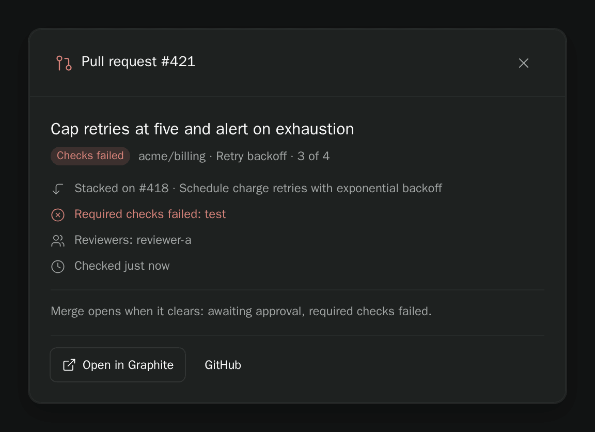

### Reviewers

**Add reviewers** asks the people you've set for that repository. Set them in **Settings → Follow-up → Reviewers**:

- Each repository Follow-up has seen a PR in gets its own list. **Default for all repos** covers every repository without one.
- **Add reviewer** suggests the repository's collaborators and teams from GitHub. You can also type a login (`octocat`) or a team as `org/team`.
- Remove a reviewer with its ×. The arrow moves a reviewer earlier in the list.

The PR sheet says who will be asked. **Edit…** opens a picker where you check or uncheck people for that PR only. **Remember for owner/repo** saves the choice as that repository's list. With nobody set, **Add reviewers** opens the picker straight away. The PR author is never asked.

The lists are yours, not your team's. Each person who installs Follow-up sets their own. If you upgrade from a version that hardcoded reviewers, each repository keeps the reviewers you last requested there. A fresh install starts empty.

The expand icon next to the gear (or **Follow-up: open the larger view** in ⌘K) opens the workspace as a full screen, in two columns when there is room: what needs you on the left, the stacks and activity on the right. Esc or the collapse icon takes you back.

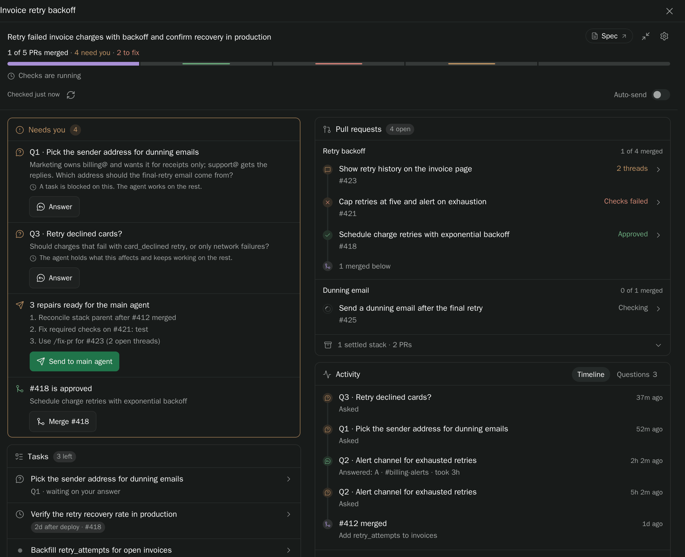

In the agent's chat, Follow-up's own tool calls collapse into one-line rows, your answers and repair batches show as short cards instead of raw prompts, and the agent's Done call gets a card of its own.

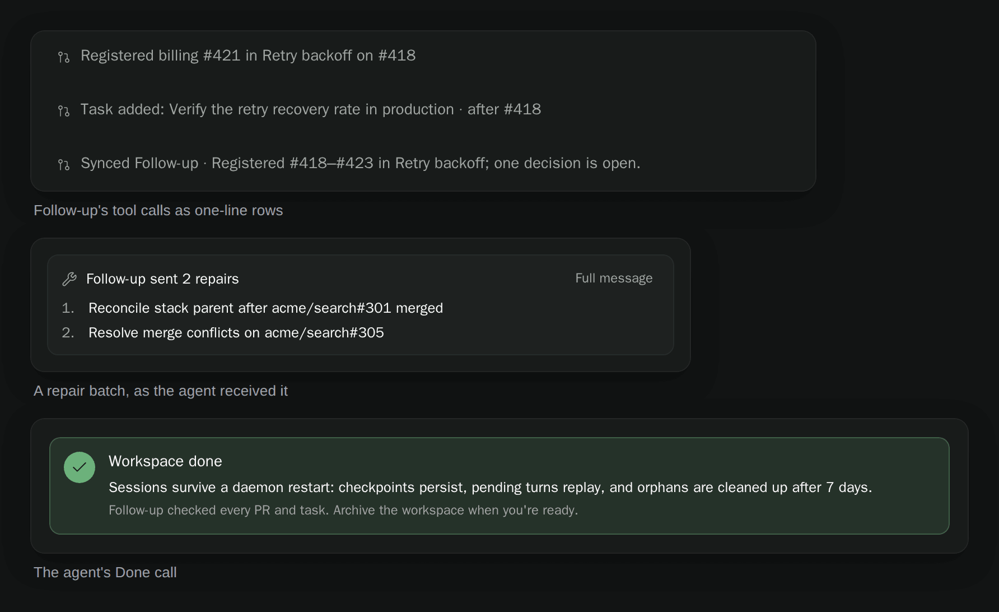

On a phone the workspace panel opens as a tab, and the PR sheet and pill popover open as bottom sheets.

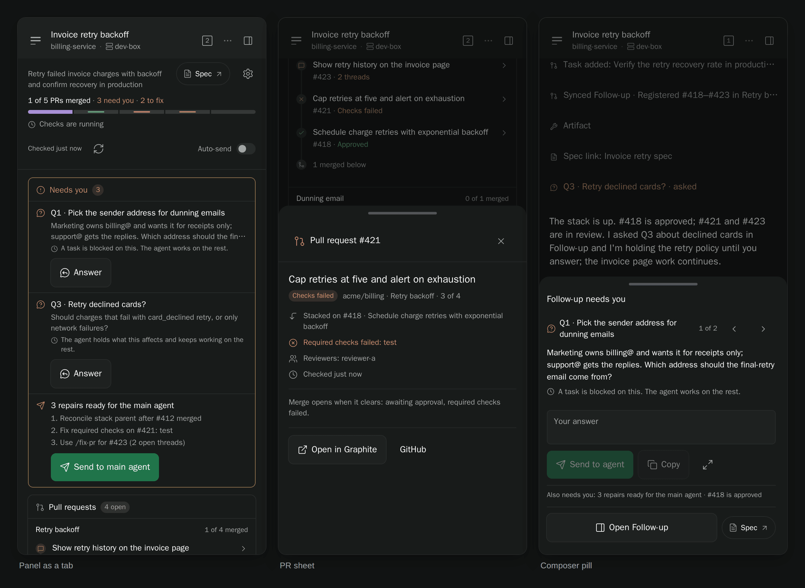

## Needs-you inbox (beta)

The 1.1 beta adds an inbox for your agents. An agent lands in **Needs you** when its turn ends, when it asks a permission or question, when it errors, when Session Guard pauses it and needs a decision, when one of its PRs has nobody asked to review it, or when the PR merges. Red CI and review threads on a tracked workspace are the agent's work: with auto-send on (the default for newly tracked workspaces) Follow-up sends the repair to the agent and nothing flags; they flag only when you have to act (auto-send off, a hold, or a stuck repair). A turn that ends with `needs_you` kind=done ("Nothing needed") doesn't flag and leaves one muted line in the chat, and while Paseo still shows an agent running, a finished turn adds nothing. It stays there until you **sign it off** or **write to it yourself**, from any device. Opening it, reading it and Paseo marking it read change nothing.

- **One pill per agent** above the composer, only while something needs you there. It leads with the one thing that matters (*Decision 4m*, *Permission 2m*, *Send 2 fixes*, *Merge #812*, *Add reviewers #1499*, *Finished 12m*), using the same order as the brief card and the Needs-you row. Click it for **Sign off**, **Sign off & next**, **Later…**, the workspace's questions and PR actions, *Mute this turn*, *Don't flag finishes* and *Open Follow-up*. After a sign-off it reads *Signed off · Undo* for 6 s.
- **Sign off** in one step: the ✓ on a row, `/ok` in the composer (`/ok next` opens the next one), or ⌘K → **Follow-up: sign off & next**. Every sign-off can be undone for 24 hours.
- **One sidebar item, Follow-up**, badged with how many agents need you (hidden at zero). It opens Home.
- **Messages from automation don't count as yours**: agent-to-agent messages, Follow-up's own repairs, Defer, Smart Session and Session Guard continuations, and schedules leave the flag in place. Their turn end flags as usual. A script calling `paseo send` without an agent envelope counts as you until Paseo reports who sent a message.
- **Don't flag finishes** (per agent, in the row's ⋯ or the composer's **More**): for agents that run on a schedule, such as a plugin auto-update. Permission prompts and errors still flag.
- **First run** imports what Paseo marks unread and idle agents from the last 7 days you never replied to. Older idle agents wait in a one-time *Unsorted* list with a confirmed *Sign off all* that one Undo reverses.
- On Paseo builds with sidebar views (Paseo `main` after 2026-11-07, expected in the next release), **Settings > Sidebar > Sidebar view > Follow-up: Needs you** puts Home's list in the sidebar.
- Everything is in one settings page, **Settings > Follow-up** (⌘K → **Follow-up: settings**): Projects, Questions, Sidebar & pills, and the Needs-you inbox. Turn the whole inbox off there. Off means nothing is flagged and no pill or sidebar item is shown.

### What you need to do, front and center (1.2 beta)

When an agent needs you, Follow-up adds a **brief** at the end of its chat, right above the composer, so it's the first thing you see when you open the agent:

- **The ask in one line**, written as what you do: *Pick how the export API is rate-limited*, *Review and merge #813*, *Allow or deny: run the migration on staging*, or *Nothing needed. Daily updates are scheduled.* The same line shows on the inbox row and in the pill's tooltip, and the pill's label comes from it (*Asks*, *Merge*, *Error*, *Paused*, *Finished*).
- **Decisions as option rows.** Click one and it goes to the agent as your message, which clears the flag. Typing the letter or the option's label in the composer counts too. On a phone, or a window too short for the whole card, each option shows its letter and label, with what it means one tap away, so the card fits above the composer.
- **Only the context needed**, plus PR facts Follow-up already knows, and the one move for this kind of ask: *Squash & merge* (Follow-up's merge flow), *Retry the turn*, *Copy error* or *Sign off & next*. Permission briefs are a single line: Paseo's own prompt right below is the control.
- **Where it came from**, always: stated by the agent, from the permission request, Session Guard, the failed turn or Follow-up's PR state. If the agent stated nothing, the card says so and points at its last paragraph. It never guesses an ask.

The content comes from a new `needs_you` tool that every root agent gets while the inbox is on, with an instruction to call it once at the end of a turn. Contributors, recovery agents and subagents don't get it. After you answer, sign off or the agent keeps going, the card folds to one muted line, so the history still shows what was asked and what happened.

**Ask agents to state what they need** (on by default, in **Follow-up: display settings**): when a Claude Code root agent ends a turn without calling `needs_you`, Follow-up's Stop hook asks it once to call it, then lets it stop. It never asks twice in one turn, and skips subagents, contributors, recovery agents and agents waiting on a permission prompt. Codex and other providers get the instruction only. The settings screen shows how often agents stated what they need over the last 7 days.

### Home (1.3 beta)

The Follow-up sidebar row (and ⌘K → **Follow-up: Home**) opens **Home**: every workspace on the left, the one you pick on the right, answered without leaving it. It replaces the old overview and tracked-workspaces screens.

- **The list**, grouped by what it needs from you: **Morning brief**, **Needs you** (blocking asks first: permissions, errors, questions; then decisions only you make, like merge and add reviewers; then finished turns to sign off, oldest first), **Follow-up is fixing** (repairs in flight), **Running**, **Waiting on others**, **Later** (snoozed) and **Quiet**, folded by project and paged, with merged and signed-off work marked ready to archive. Each row has the last ask or action, up to two badges, the PR with its checks, and the age.
- **The detail pane** for the selected row: the brief (the ask, decisions as buttons), Allow / Deny for a pending permission, merge and add-reviewer actions, **Sign off**, **Sign off & next**, **Later…**, the agent's last few steps (read only for that agent), and a reply box. Sending a reply is you writing to the agent, so it clears Needs you. Only one button on screen is filled.
- **The brief pane** when nothing is selected: a headline that names the first move, who you're waiting on, what cleared since the last workday, **Done while you were away** (what Follow-up did on its own, with a link to the full log) and how fresh Paseo and GitHub data is.
- **Open full** opens the agent's chat and docks that workspace's own panel in its explorer column (its PR stack, tasks, questions, repairs, activity and **Details**). Its **Home** button goes back. On a phone, Home is the list and a row opens a full-height detail.

#### Beta 2: search, sort, status at a glance

- **Status strip**, pinned above the list: counts for **Needs you · Fixing · Running · Waiting · Quiet** (plus Later and "to archive" when there are any). A count shows only that group; press it again or **Show all** to go back. Zero counts stay, muted. The sidebar badge and the brief headline use the same counts.
- **Provider limits** under it, from the [Smart Session](https://www.npmjs.com/package/paseo-smart-session) plugin: one line per provider, such as "Claude 5h 62% · 7d 41% · resets 14:10". Amber from 80%, red at the limit; tap a line to see each ZeroSub account. The age shows when the reading is older than 15 minutes. Without Smart Session the line isn't there.
- **Search** ("Search workspaces, branches, PRs"; `/` or ⌘K → **Follow-up: Search** focuses it) matches workspace names, branches, PR numbers ("#1402" or "1402") and titles, agent and subagent titles, the project, Linear keys such as HER-1312, and the current ask. Words can come in any order, prefixes count and one typo is forgiven. Results are one ranked list (name above branch and PR above the ask, then recency) with the matched words marked and each row's group as a chip; archived workspaces come last. ↑/↓ move, Enter opens the result on the right, Esc clears.
- **Sort** (the menu beside search, remembered on this device): **Priority** (default), **Recent**, **Oldest waiting**, **Name** and **By project**. It orders rows inside each group; groups stay in place and search ignores it. Priority means urgency: blocking asks, then decisions only you make, then finished turns; inside those, a big open question first, then the nearest task deadline, then the oldest ask. When an agent has ranked workspaces with `set_priorities` in the last 6 hours, Priority uses those scores inside Needs you (blocking asks still first), each row shows the ranker's one-line reason and source, and the menu says "Ranked 12m ago"; otherwise it says "By urgency". Follow-up never writes a reason itself.
#### Summary

When a workspace's name doesn't remind you what it's for, open **Summary** at the top of Home's detail pane or the workspace panel (under Home). It's collapsed by default and remembers open or closed on this device. Collapsed, it shows a one-line gist once one is written ("Fix slow vendor-activity query; PR #1352 merged, waiting on Hadar"). Open, it shows:

- **An overview**: two to four plain sentences on what the workspace is for, where it stands and what it's waiting on, written by a small model from the root agent's first messages and latest steps, its subagents' titles, its PRs and the linked issues. While it's being written you see "Summarizing…" with the first message.
- **Linked**: Linear issues (key, title, state, priority, due), PRs (number, title, state), Slack threads (channel, who, a one-line excerpt) and claude.ai or doc links the agent shared, each with a source chip. Links are only ever found in the workspace's own text, never written by the model; with none it says "No linked issues or threads found".
- **A footer** with when and from what it was summarized ("Summarized 2h ago from the saved transcript, 2 PRs, HER-1312"), any source that couldn't be read, and **Refresh**.

An overview is written when you open the section and none exists, or when the inputs changed and it's over an hour old, or on Refresh. Workspaces in Needs you get one ahead of time (at most 60 a day). Agents can read it with the read-only `workspace_about` tool.

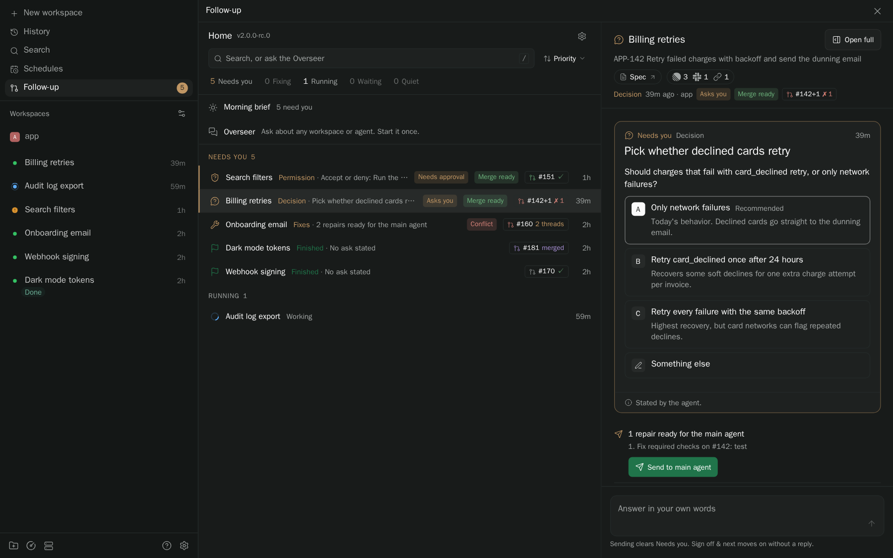

- ⌘K: **Follow-up: Home**, **Follow-up: Search**, **Follow-up: Sign off & next**, **Follow-up: Later (tomorrow 09:00)**, **Follow-up: Next needs-you**, **Follow-up: Done while you were away**.

### The Overseer (1.4 beta)

One agent you talk to about all your workspaces. It sits pinned at the top of Home's list, under the morning brief. Click **Start the Overseer** once, and Follow-up creates it in its own workspace, which is never tracked, never shown under Needs you, and never sent repairs. Its row shows whether it is idle, working, or asking you something. Selecting it opens the conversation in the right pane with a reply box, and **Open full** opens its chat.

**Ask from anywhere.** Type in Home's search box and the last row is always **Ask the Overseer: <what you typed>**. Arrow down to it and press Enter (or tap it), and it goes to the Overseer as you wrote it. The search clears and its conversation opens. If no workspace matches, it is the only row, so Enter sends it straight away; a single word that matches nothing waits for ↓ or a tap, so a typo never reaches an agent. The first ask starts the Overseer, so you don't have to click Start first. While the Overseer is on, ⌘K → **Follow-up: Ask the Overseer** opens it from any screen with the reply box focused. Both work on the phone too.

- **It routes your asks; it doesn't do the work.** "Tell the HER-1312 agent to use option A" goes to the agent that owns HER-1312, and the Overseer answers in one line: "Sent to Okta SCIM sync (key HER-1312)". It scores candidates by Linear key, PR number, branch, workspace name, open asks and recent activity. When no candidate stands out, it asks you with a decision (the top two or three plus **New workspace**) instead of guessing.
- **What it forwards keeps your voice.** A forwarded message starts "From the developer via Overseer:". It clears that agent's Needs-you flag only when it answers the agent's open ask. A new task leaves the ask standing.
- **New workspaces only on your word.** It starts one, branched off main and named from the task, only after you asked or picked **New workspace**, and only through a dry run and confirm.
- **Never merges, approves, closes, archives or posts to people.** Those stay yours.
- **It is cheap to keep.** Each turn begins with a digest of what changed since the last one, built from Paseo's workspace metadata and Follow-up's own state. That's about 800 tokens at 100 workspaces, with resting workspaces in one line. The digest file is rewritten only when its content changes, and not at all while the resource governor pauses background work. The Overseer never reads the timeline of an agent that isn't loaded, because that would load the agent for an hour. Instead it reads the agent's transcript from disk, or Follow-up's cached goal and PRs. Sending to a resting agent wakes it, so that happens only when you ask for it, and the reply says "woke …".
- **Archived it by accident?** Follow-up starts a new one with a handoff from the old one's last steps.

Turn it off under Settings → **Overseer (beta)**. While it's off, search has no ask row.

#### AI priority (1.4 beta)

Home's **Priority** sort can come from a ranker that reads what's happening outside Paseo: your assigned Linear issues (priority, due date, project and milestone), Slack DMs and mentions from the last 48 hours, open GitHub review requests, and the CPO's weekly planning artifact. Each row then shows a one-line reason that names its source, such as "HER-1312 · Urgent · due today" or "Slack: Dana asked twice". Needs you still comes first, whatever the score.

- **When it runs:** about once an hour, Sunday to Thursday from 08:00 to 20:00 Israel time. **Re-rank now** in the sort menu runs it at any time, and so does asking the Overseer what to work on first. The menu says when it last ranked and names any source it couldn't read ("Ranked 12m ago · Slack unavailable").
- **What it costs:** it calls the model only when its inputs changed since the last run, and at most 24 times a day (Re-rank now isn't capped). A run at about 100 workspaces is one Sonnet call of roughly 10k input tokens, about $0.06 and 20 s. The weekly plan is read at most once a day, for about $0.03. Each run's cost and duration go to `ai-jobs.jsonl`.
- **What it touches:** everything is read-only: Follow-up's own state, read-only Linear and Slack tools through mcpproxy, `gh search prs`, and one read of the planning artifact with Claude's Artifact tool and no other tools. It never posts, comments or publishes. The artifact's link comes from `FOLLOW_UP_PLAN_URL`, or else from the morning-brief skill's source list (link only, without any share key).
- Linear issues assigned to you that no workspace covers are kept for a later "Not started" group; they aren't shown yet.

Turn it off under Settings → **Overseer (beta)** → **AI priority**.

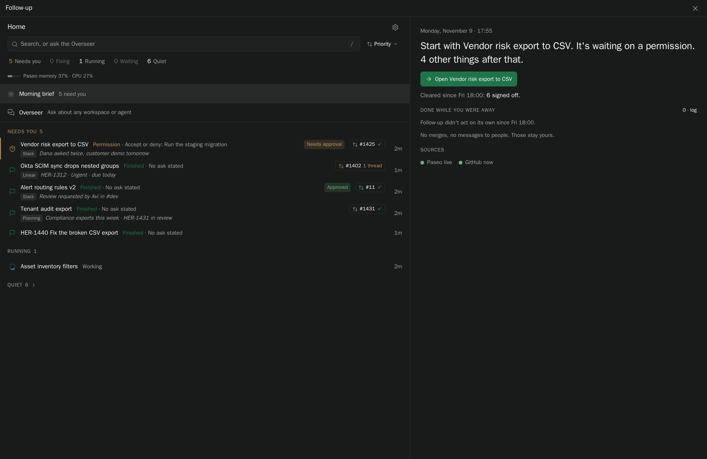

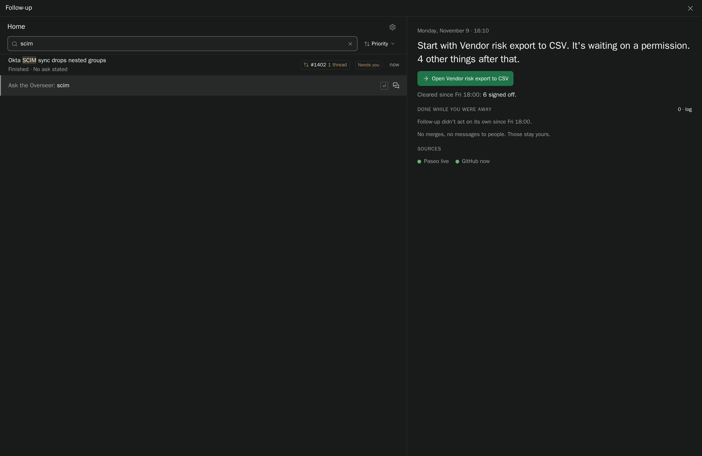

### Choosing models

Settings → **Agents** has one card for each agent Follow-up runs for you. Each card says what the agent does and what it uses now ("Claude · Haiku"). It lets you pick the provider, model, effort and, for full agents, the permission mode, and each card has **Reset to default**. The list comes from the providers and models Paseo knows about, read when you open the screen. Providers that aren't installed or are turned off are listed with the reason.

| Agent | Default | Notes |
|---|---|---|
| Summaries | Claude · Haiku | One small call per summary, no tools. Claude (`claude -p`) or Codex (`codex exec`). Also sets how many overviews are written ahead per day (60). |
| Overseer | Claude · newest Opus, Bypass | A change applies when you restart it. Its pane on Home offers **Restart with …**, and the new Overseer gets the old one's last steps. |
| Recovery | Same as main agent | Or pick a provider and model. Switching provider keeps the main agent's tools and instructions. |
| Priority ranker | Claude · Sonnet, hourly, up to 24 a day | One call per run, no tools. Claude or Codex. |

The choices live in `agents.json` in Follow-up's data folder. Anything missing or invalid there falls back to the default. Agents can read the choices with the read-only `agent_settings` tool. The About footer names the model that wrote each overview ("Summarized by Haiku · 2h ago").

### Wait for background jobs (1.4.0-beta.24)

Claude agents often start a long command in the background (tests, a build, a deploy check) and then end their turn "waiting for a notification", which leaves the workspace looking idle while it isn't done. With **Wait for background jobs** (Settings → Agents, on by default), every Claude agent Paseo starts gets three small tools:

1. `wait_prepare_job({description, command})` records the job and returns a `bashCommand`. It runs nothing.
2. The agent runs that exact command with Bash in the background, as it would anyway.
3. `wait_for_job({jobId})` keeps the agent Running for up to 60 seconds (30 by default) and returns **completed** or **failed** with the exit code, **still_pending** (the agent checks the output with `wait_get_job` and waits again) or **new_message** (you wrote to it).

Only the command's exit receipt counts as done. Stop ends the wait without killing the command, and a new message ends it too. Each agent sees only its own jobs, and the records survive Follow-up updates. Nothing runs while no agent is waiting: no extra process, no port, no polling.

This replaces the separate **Wait** plugin (`paseo-wait`). While that plugin is installed and enabled, Follow-up's Wait stays off and Settings says so. Disable or remove it to switch: `paseo plugin disable paseo-wait`. Agents opened afterwards get Follow-up's Wait; already-open sessions switch on their next prompt. Wait needs Paseo 0.15+ with its agent tools on (the default). To leave one agent without it, give the agent the label `follow-up-wait/enabled=false` (the older `paseo-wait/enabled=false` and `plugin-tools/enabled=false` also work).

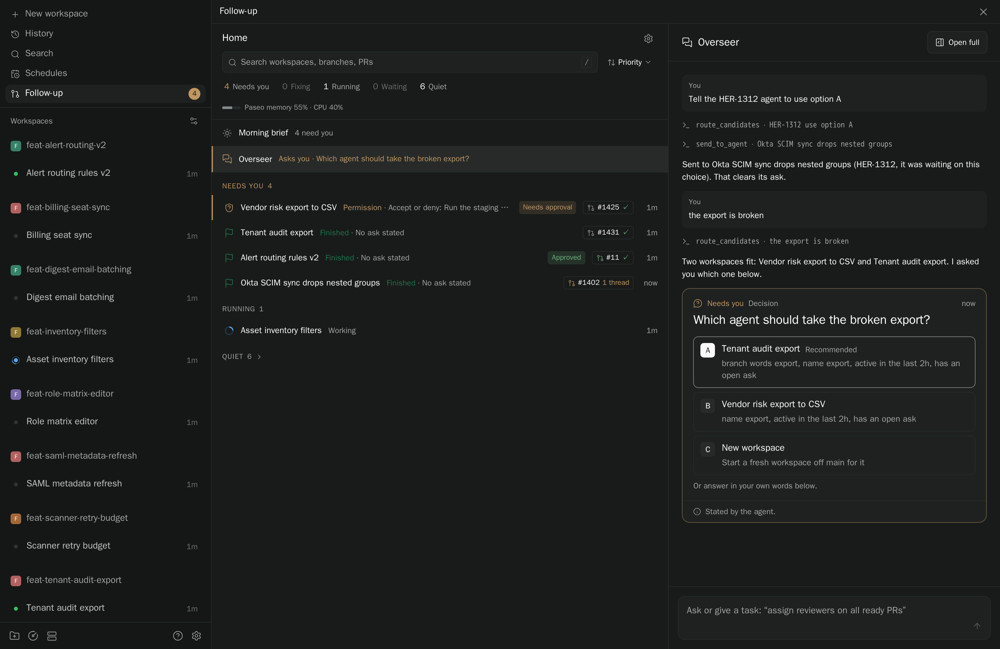

Install the beta:

```sh
paseo plugin update follow-through --version 1.4.0-beta.47
# or, for a fresh install:
paseo plugin install npm:paseo-follow-up@beta
```

Go back to the stable release (the inbox file stays on disk and is ignored by 1.0.1):

```sh
paseo plugin update follow-through --version 1.0.1
```

Betas publish to npm's `beta` dist-tag, so `paseo plugin update` without `--version`, and scheduled updates that follow `latest`, never pick one up.

## How it works

- The workspace's main agent owns its PRs, tasks, questions, the spec link and the Done call. Other agents in the workspace can register PRs and check status.
- **Follow every workspace** (on by default since 1.3.0-beta.2): every workspace with an agent is followed, and **Send repairs automatically** (also on by default) means review threads and red CI go to the agent without you. The first start of 1.3.0-beta.2 backs up `state.json` to `state.before-follow-every.json.bak`, then turns following and auto-send on for every workspace Follow-up already knew. Turn auto-send off for one workspace under **Workspace exceptions** and each repair batch waits for your click; with it on, Follow-up sends batches itself once the agent is idle, after fresh permission and Session Guard checks.
- Follow-up never merges, turns on merge when ready, requests reviewers or archives on its own. **Merge** re-checks the stack, lists any PRs underneath that would merge first, and asks again.
- A merged PR is not the end: tasks such as production checks and open questions keep the workspace open until the main agent declares Done and everything has settled.
- Answers go out only when you click Send. Follow-up never answers for you.
- **It stays light on Paseo (1.4).** Follow-up keeps one shared view of Paseo's agents and workspaces. It reads the full list once at start, then updates it from Paseo's events: turns, permissions, archives and new agents or workspaces. It re-reads the list at most once a minute after a change, and every ten minutes otherwise. Home, the workspace panel, the pills and the Needs-you inbox all read that shared view, so opening them never makes Paseo list your workspaces again. In the app, the panel and pills draw from one shared poll that refreshes when an agent changes. The Needs-you list answers "unchanged" in a few bytes when nothing moved, and nothing polls while the app is in the background. At 120 workspaces and idle, Follow-up's worker makes about 1 request a minute to Paseo, down from about 60. With the app open it was about 140.

### Agents can do what you can click

Tell an agent "the PRs look good, assign reviewers on all" and it can do it. Every root agent Paseo launches gets Follow-up's action tools, which run the same server code as the buttons, so the inbox, briefs and PR state change exactly as if you clicked:

| Tool | Does what this button does |
| --- | --- |
| `list_prs` | Reads tracked PRs across all workspaces (draft, checks, threads, reviewers, merge blockers). Filters: `needs_reviewers`, `ready_to_merge`, `workspace`. |
| `add_reviewers` | **Add reviewers**, on one PR or many. Uses your saved reviewers for the repository, or the logins (or `org/team` slugs) you name. `list_prs` shows each PR's saved reviewers as `configuredReviewers`. |
| `merge`, `enable_merge_when_ready`, `disable_merge_when_ready` | **Merge** and the PR sheet's merge-when-ready switch, with the same plan and blockers. |
| `send_repairs`, `set_auto_send`, `clear_hold`, `retry_batch`, `track` | **Send**, the **Auto-send** switch, **Resume**, **Retry**, following a workspace again after an opt-out. |
| `set_priorities` | Stores external priorities for Home's Priority sort: per workspace a score 0–100, a one-line reason and sources (Linear, Slack, planning, GitHub, Paseo). Plans first; `confirm: true` with the plan id stores them. Used for 6 hours. |
| `inbox_list`, `sign_off`, `snooze`, `set_finish_flags` | The Needs-you list, **Sign off**, **Later** and **Don't flag finishes**, for other agents only. |
| `agent_settings`, `set_wait_for_jobs` | Reads Settings → Agents; turns **Wait for background jobs** on or off (plans first). |

Tools that act on a list, and merge, return a dry run first and act only when called again with `confirm: true` and that plan's id. Their descriptions tell the agent to use them only when you asked. An agent can't sign itself off. Recovery agents, contributors and subagents don't get these tools, and the daemon checks the caller again on every call.

## Send to Paseo and Graphite

With [Send to Paseo](https://github.com/tomgrin10/send-to-paseo) on the same daemon, its composer picks the agent that registered the PR. In Graphite repositories, with Send to Paseo 2.2+, Follow-up can also toggle Graphite's **Merge when ready** through your existing pairing, while Graphite is open and signed in. Each change is confirmed in Chrome, which can remember the permission per repository. With the next Send to Paseo release, its popover on a PR page also shows which tracked workspaces own the PR, with Follow-up's one line for each (for example "Needs you · Merge ready"), and opens the workspace's main agent in the Paseo app or web app. See the [integration and security contract](https://github.com/tomgrin10/send-to-paseo/blob/main/docs/follow-up-integration.md).

## Data and access

Paseo plugins run trusted, unsandboxed code on the daemon host. Follow-up reads workspace metadata, agent history and GitHub PR status with your existing credentials, and keeps its state in `$PASEO_HOME/plugin-data/follow-through`. It registers scoped MCP tools and reversible provider hooks only for tracked sessions, plus the action tools for root agents (above). GitHub (and, in Graphite repositories, Graphite) writes happen only after an explicit click, or a root agent's confirmed plan, and a fresh eligibility check.

## Development

```sh
npm ci
npm run verify
npm run test:install
paseo plugin reload follow-through   # after changes
```

Integration checks use a separate Paseo home with synthetic agents. Working on Follow-up with an agent? Start at [AGENTS.md](AGENTS.md): the architecture map, a file index per subsystem, the invariants, and the docs in [docs/](docs/).

Release notes: a PR that changes something users see adds `changes/<branch>.md` with one to three plain-language bullets ([rules](changes/README.md)). Before a stable version bump, `npm run release:notes <version>` moves them into CHANGELOG.md (`-- --allow-empty` for a release with nothing user-facing). For a beta it writes nothing and the fragments wait for the next stable release. `npm run verify` fails if a stable package version has no notes.

Version tags (`vX.Y.Z`) publish to npm through Trusted Publishing.

## License

[MIT](LICENSE) © 2026 Tom Gringauz.

Questions, question modes and the activity log are adapted from [Progress](https://github.com/stevecastaneda/paseo-plugins/tree/main/progress) by Steve Castaneda (MIT). Its notice is in [THIRD_PARTY_NOTICES.md](THIRD_PARTY_NOTICES.md).

## Other plugins

- [Defer](https://github.com/tomgrin10/paseo-defer) — Schedule messages for later delivery.
- [Send to Paseo](https://github.com/tomgrin10/send-to-paseo) — Send GitHub and Graphite PRs to Paseo from Chrome.
- [Session Guard](https://github.com/tomgrin10/paseo-session-guard) — Pause at session limits and continue after reset.
- [Smart Session](https://github.com/tomgrin10/paseo-smart-session) — Context compaction and usage insights.
- [Transcript Search](https://github.com/tomgrin10/paseo-transcript-search) — Search conversations across connected hosts.
- [Transfer](https://github.com/tomgrin10/paseo-transfer) — Copy or move workspaces between hosts.
- [Vitals](https://github.com/tomgrin10/paseo-vitals) — Host, process, agent and Docker monitoring.
- [Workspace Switcher](https://github.com/tomgrin10/paseo-switcher) — Arc-style Ctrl+Tab between recent workspaces.
