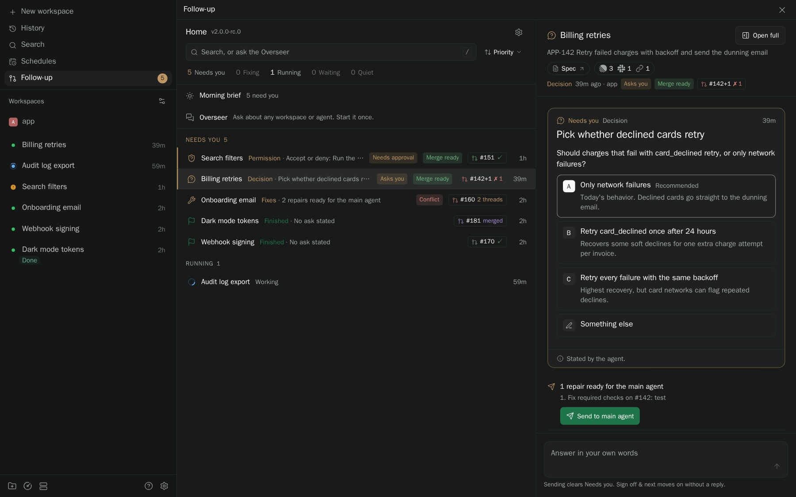

# Follow-up

[](https://www.npmjs.com/package/paseo-follow-up)
[](https://paseo.sh)
[](LICENSE)

A [Paseo](https://paseo.sh) plugin that follows every workspace your coding agents work in until the work is merged.
One list shows which agents are waiting on you and why.



## Install

```sh
paseo plugin install npm:paseo-follow-up
```

You need Paseo 0.15 or later, Node 22+ and a signed-in GitHub CLI (`gh`) on the machine Paseo runs on. Then open
Follow-up in Paseo's sidebar. A two-minute setup walks you through the rest.

## What you get

- One list of every workspace, with the ones that need you at the top.
- Answer an agent's question from the list, the side panel, the chat or your phone, without opening its chat.
- Failed checks, merge conflicts and review comments go back to the agent that made the PR, by themselves.
- A one-line summary of each workspace, plus the Linear issues, Slack threads and docs it's about.
- Ask one agent about all your workspaces from Home's search box.
- Background jobs run on any model Paseo has, and your agents can do anything you can click.
- It updates itself when nothing is busy and rolls back if an update fails.

## What it never does on its own

- Merge, request reviewers or archive. Those take your click, or an agent's plan that you confirmed.
- Answer a question for you.
- Wake a resting agent. It reads the transcript on disk instead.

It runs on your machine with your own GitHub sign-in. [OVERVIEW.md](OVERVIEW.md) says exactly what it reads and
writes.

## Docs

- [Using Follow-up](docs/guide.md): setup, the panel, the pill, settings, helper agents, updates, reporting a bug,
  upgrading from 1.x and memory on Linux.
- [CHANGELOG.md](CHANGELOG.md): release notes.
- [AGENTS.md](AGENTS.md): how it's built and how to work on it.

Questions or bugs: ask any agent in Paseo to "report a bug about Follow-up", or
[open an issue](https://github.com/tomgrin10/paseo-follow-up/issues/new/choose).

## Credits

Ideas borrowed, with thanks, from [Progress](https://github.com/stevecastaneda/paseo-plugins/tree/main/progress) by
Steve Castaneda (questions with lettered options; MIT, see [THIRD_PARTY_NOTICES.md](THIRD_PARTY_NOTICES.md)) and
[Better Paseo](https://github.com/RoundRedDot/better-paseo) by RoundRedDot (the grouped Home list).

## Other plugins

[Defer](https://github.com/tomgrin10/paseo-defer),
[Send to Paseo](https://github.com/tomgrin10/send-to-paseo),
[Session Guard](https://github.com/tomgrin10/paseo-session-guard),
[Smart Session](https://github.com/tomgrin10/paseo-smart-session),
[Transcript Search](https://github.com/tomgrin10/paseo-transcript-search),
[Transfer](https://github.com/tomgrin10/paseo-transfer),
[Vitals](https://github.com/tomgrin10/paseo-vitals) and
[Workspace Switcher](https://github.com/tomgrin10/paseo-switcher).

## License

[MIT](LICENSE) © 2026 Tom Gringauz.
