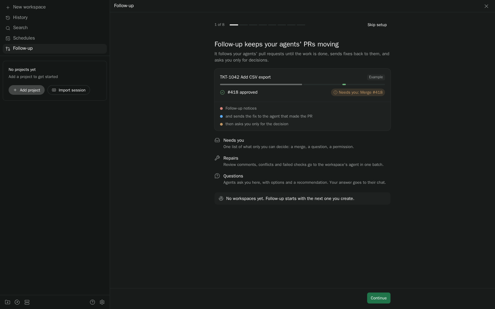
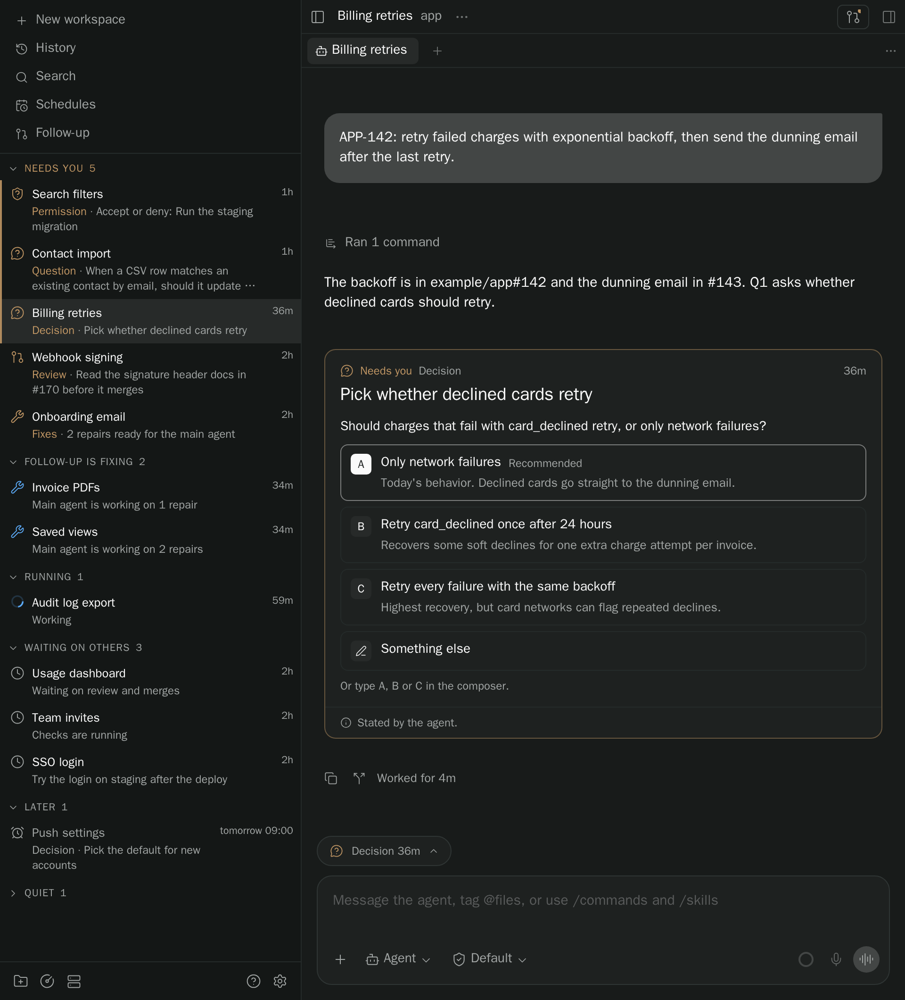
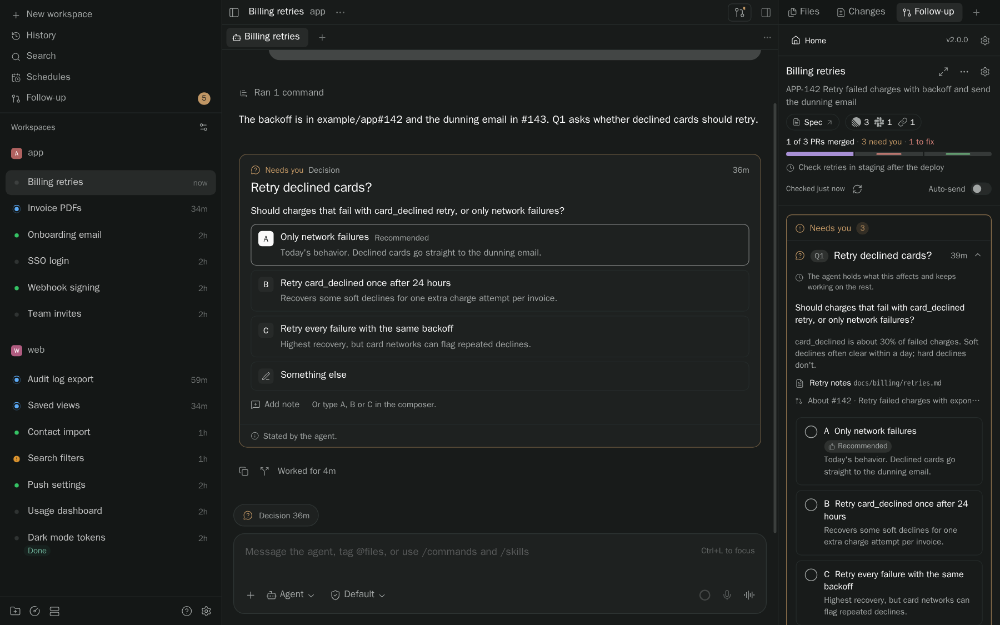
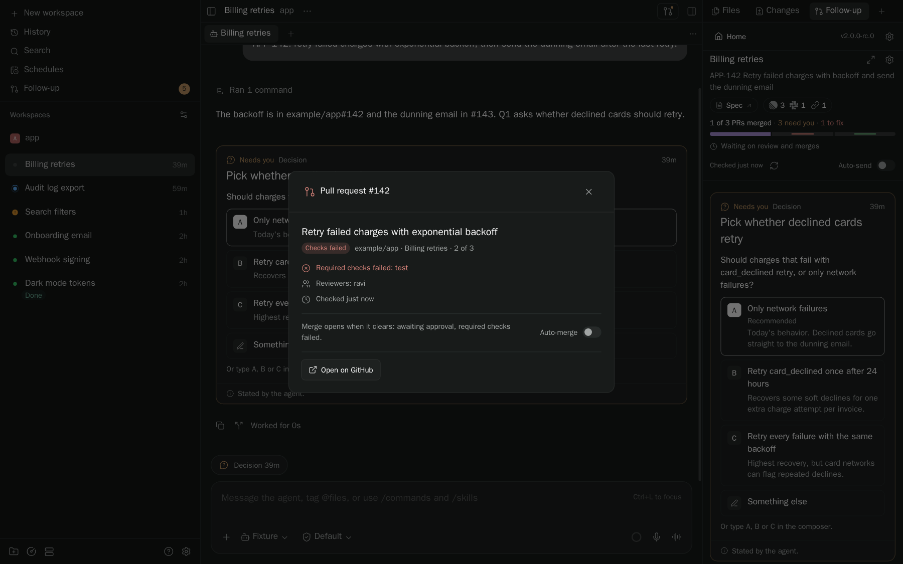
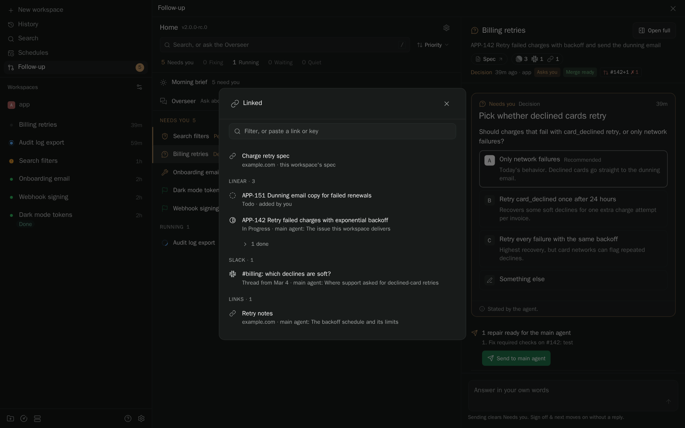
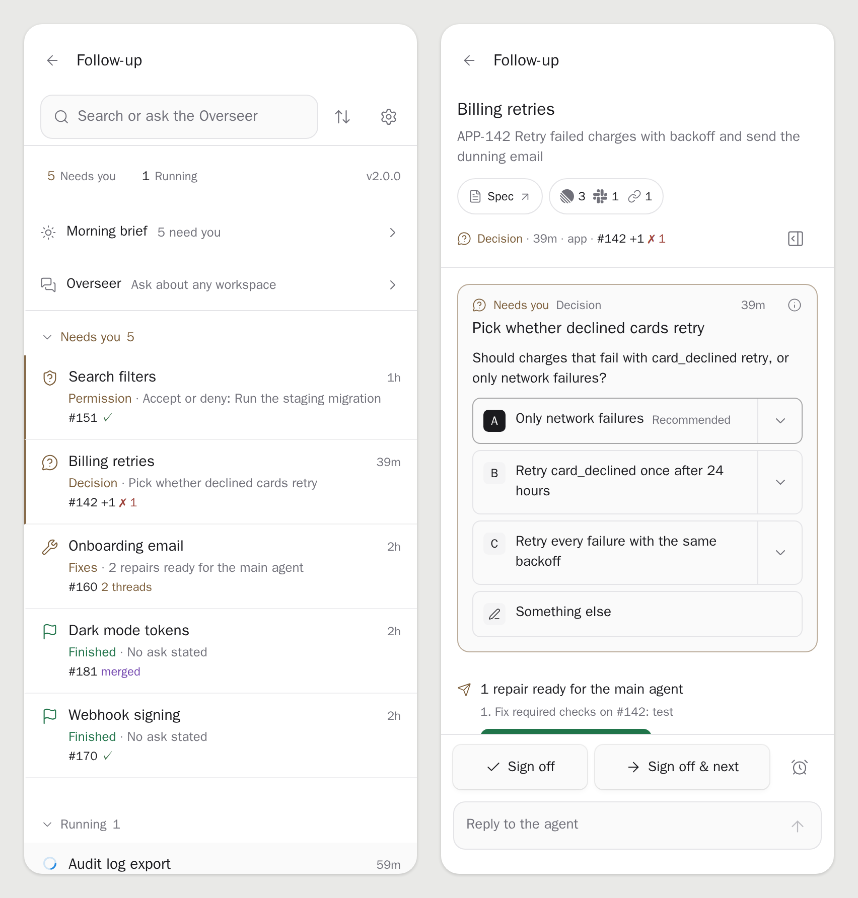

# Follow-up

[](https://www.npmjs.com/package/paseo-follow-up)
[](https://www.npmjs.com/package/paseo-follow-up)
[](https://paseo.sh)
[](LICENSE)

Follow-up is a [Paseo](https://paseo.sh) plugin that keeps track of every workspace your coding agents work in, until
the work is merged and done. It shows you in one place which agents are waiting on you and why, sends failed checks and
review comments back to the right agent by itself, and lets you answer an agent's question without opening its chat.


Screenshots use synthetic workspaces, people and PRs.

## Install

```sh
paseo plugin install npm:paseo-follow-up
```

Needs Paseo 0.15 or later, Node 22+ and a signed-in GitHub CLI (`gh`) on the machine the Paseo daemon runs on. Then
open **Follow-up** in Paseo's sidebar; a two-minute setup walks you through the rest.

## What you can do

- **See everything that needs you in one list.** Home lists every workspace, grouped by what it needs from you. When
  an agent finishes, asks something, hits an error or waits for a permission, it moves to the top, under **Needs you**,
  and stays there until you mark it done or reply. You act on it right there, without opening the chat.
- **Answer agents from anywhere.** When an agent needs a decision, it asks in a card with lettered options, its
  recommendation and room for your own answer. Answer on Home, in the workspace's side panel, in the bar above the
  agent's message box, or on your phone. The answer goes straight into the agent's chat.
- **Let fixes go back to the agent.** When a PR's checks fail, it hits a merge conflict or a reviewer leaves comments,
  Follow-up sends them to the agent that made the PR, in one message once it's idle. You're only asked for what's yours
  to decide, like merging. Works with plain GitHub; Graphite is optional.
- **Know what each workspace is about.** A one-line description of what it's for, and the Linear issues, Slack threads
  and docs it's about.
- **Ask about any workspace.** Type in Home's search box and an agent that knows all your workspaces passes your
  question to the one doing the work. Optionally, Follow-up orders the list by what your Linear issues, Slack mentions
  and review requests say matters most.
- **Use your own models.** Its small background jobs, like writing those descriptions, run on any model provider Paseo
  has. Your agents can do anything you can click in Follow-up, after showing you a plan.
- **Forget about it.** It updates itself when nothing is busy, rolls back if an update fails, and stays light on the
  machine.

## Setup

The first time you open Follow-up from the sidebar, a short setup takes Home's place. It takes about two minutes, and
**Skip setup** leaves it at any point.



It shows what Follow-up does, checks GitHub and the helper agents (with the fix to copy for anything missing), and asks
what Follow-up may do without asking you, how you ship PRs, who reviews, how it updates and which helpers to turn on.
Every switch is the same one Settings shows. Run it again from Settings → General → **Set up Follow-up again**.

## Using it

Open **Follow-up** in Paseo's sidebar for Home, or the Follow-up icon in a workspace's header for that workspace's
panel. ⌘K (Ctrl+K) has a Follow-up command for most things.

On Paseo 0.16 or newer, Follow-up can also be your sidebar: pick **Follow-up: Needs you** in Settings → Sidebar →
View. Follow-up 2.0 still runs on Paseo 0.15; there it simply doesn't offer the view.





- **Answer a question.** Pick an option, add a note if you like, and send. Cmd+Enter (Ctrl+Enter) sends. If the agent
  is busy or waking up, the card says Sending until it has the answer, and offers Send again if it couldn't deliver.

  

- **The bar above the message box** (the pill) shows what needs you in the chat you're in, with the same actions.

  

- **A PR.** Tap a PR, or its segment in the stack bar, for its checks, reviewers and Merge. When Merge isn't available
  yet, the sheet says what it's waiting for. Follow-up never merges on its own, and Merge checks the stack again first.

  

- **Linked items.** Next to a workspace's Spec: the Linear issues, Slack threads and docs it's about, with who linked
  each one and why. Paste a link or a key to add one. Agents link what they start from, and a Linear key counts only
  once Linear confirms it.

  

- **On a phone**, Home is the list and a row opens its detail. Sheets open from the bottom.

  

After a major update, Follow-up shows **What's new** once. Smaller updates and betas install quietly. Release notes
are in Settings → General and in [CHANGELOG.md](CHANGELOG.md).

## Helper agents and providers

Follow-up runs a few small background jobs ("helpers") for you. Each one is optional, and Settings → **Agents** shows what each uses and
recommends a model from the providers you have, with **Use recommended** in one click.

| Helper | What it does | Runs on |
| --- | --- | --- |
| Summaries | One sentence under each workspace's title saying what it's for | Any provider Paseo has |
| AI priority | Sorts Home from Linear, Slack and review requests, about hourly on workdays, and only when something changed | Any provider Paseo has |
| Overseer | One agent you ask about all your workspaces. Starts only when you click Start on Home | A Paseo agent, Claude by default |
| Recovery | Rebuilds a workspace's tracking when Follow-up lost track of it. Runs only when you ask | The main agent's provider, or one you pick |

Claude and Codex run a job directly. Other providers run it as a short hidden agent. AI priority reads Linear and
Slack through read-only tools and never posts anything.

## Settings

Settings (the gear on Home, or ⌘K → **Follow-up: settings**) has five categories:

- **General.** Updates (Install automatically, Tell me or Off; Stable or Beta), setup, and the release notes.
- **Following.** Which projects and workspaces Follow-up follows, auto-send, how each repository ships PRs (GitHub or
  Graphite, the merge method, how agents handle review comments), and Trust bypass for permission prompts.
- **Reviewers.** Who **Add reviewers** asks: a default for every repository and a list per repository.
- **Agents.** The helper agents and their models, what agents do while a question waits, and, on Paseo 0.15, Wait for
  background jobs.
- **Inbox & display.** The Needs-you inbox, the sidebar badge and the pills.

## What Follow-up never does on its own

- Merge, turn on merge when ready, request reviewers or archive. Those take your click, or an agent's confirmed plan.
- Answer a question for you. Answers go out only when you send them.
- Wake an agent that's resting to read it. It reads the transcript on disk instead.

## Report a bug or request a feature

Ask any agent in Paseo to "report a bug about Follow-up" (or a feature request, or feedback), or use **Report a bug**
in Settings → General, Command-K, `/report-issue` in the composer, or **Report this** on any error. The agent asks what
it needs, checks what it can, and shows you the exact issue before filing it in this repository with your own GitHub
sign-in. It adds Follow-up's version, Paseo's, your OS and recent errors, and replaces private repository names, PR
titles, hostnames, emails and paths with placeholders. Screenshots are uploaded to a public `paseo-issue-assets`
repository in your account only if you say yes for that report; otherwise you drag them into the issue. Without a
GitHub sign-in you get a prefilled link instead. You can also [open an issue](https://github.com/tomgrin10/paseo-follow-up/issues/new/choose) by hand.

## Upgrading from 1.x

Update as usual. 2.0 copies your data to its new folder and moves itself to the plugin id `follow-up` once, while
nothing is busy; Settings → General says when it's done. 2.0 needs Paseo 0.15 or later. To go back to 1.0.1:

```sh
paseo plugin remove follow-up
paseo plugin install npm:paseo-follow-up@1.0.1
```

1.x's data folder is never deleted, so 1.0.1 starts from where it was before the move.

Betas are on npm's `beta` dist-tag: `paseo plugin install npm:paseo-follow-up@beta`.

## Data and access

Paseo plugins run trusted, unsandboxed code on the daemon's machine. Follow-up reads workspace metadata, agent history
and GitHub PR status with your existing credentials, and keeps its state in `$PASEO_HOME/plugin-data/follow-up`. It
gives agents scoped tools and installs reversible hooks for Claude Code and Codex. [OVERVIEW.md](OVERVIEW.md) has the
full data-access statement.

## Docs

- [CHANGELOG.md](CHANGELOG.md): release notes.
- [AGENTS.md](AGENTS.md): start here to work on Follow-up, with or without an agent. The architecture, invariants and
  how to test.
- [docs/](docs/): one page per part, such as [Needs you](docs/needs-you.md), [PRs](docs/prs.md),
  [Linked items](docs/linked-items.md), [updates](docs/updates.md), [Wait](docs/wait.md) and
  [agent tools](docs/rpcs-and-tools.md).

## Development

```sh
npm ci
npm run verify
npm run test:install
npm run shots          # re-shoots the README images in an isolated daemon
```

Checks run against a separate Paseo home with synthetic agents, never your own. A PR that changes something users see
adds a release-note fragment ([rules](changes/README.md)), and releases are described in
[docs/releasing.md](docs/releasing.md).

## Credits

Follow-up borrows ideas from other Paseo plugins. Thank you to their authors.

- [Progress](https://github.com/stevecastaneda/paseo-plugins/tree/main/progress) by Steve Castaneda: questions with
  refs, lettered options and a recommendation, the question modes and the activity log are adapted from it (MIT, see
  [THIRD_PARTY_NOTICES.md](THIRD_PARTY_NOTICES.md)).
- [Better Paseo](https://github.com/RoundRedDot/better-paseo) by RoundRedDot: its Tasks board, every agent in lanes by
  state, shaped Home's grouped list and the reply box in its detail pane.

## Other plugins

- [Defer](https://github.com/tomgrin10/paseo-defer): schedule messages for later delivery.
- [Send to Paseo](https://github.com/tomgrin10/send-to-paseo): send GitHub and Graphite PRs to Paseo from Chrome.
- [Session Guard](https://github.com/tomgrin10/paseo-session-guard): pause at session limits and continue after reset.
- [Smart Session](https://github.com/tomgrin10/paseo-smart-session): context compaction and usage insights.
- [Transcript Search](https://github.com/tomgrin10/paseo-transcript-search): search conversations across hosts.
- [Transfer](https://github.com/tomgrin10/paseo-transfer): copy or move workspaces between hosts.
- [Vitals](https://github.com/tomgrin10/paseo-vitals): host, process, agent and Docker monitoring.
- [Workspace Switcher](https://github.com/tomgrin10/paseo-switcher): Arc-style Ctrl+Tab between recent workspaces.

## License

[MIT](LICENSE) © 2026 Tom Gringauz.
