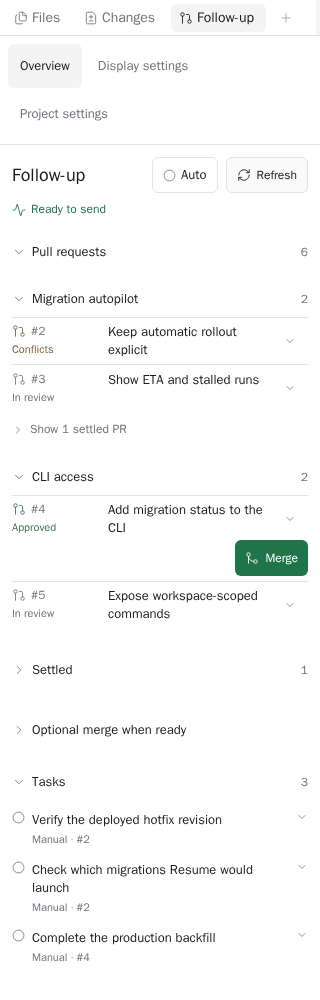

# Paseo Follow-up

[](https://www.npmjs.com/package/paseo-follow-up)
[](https://www.npmjs.com/package/paseo-follow-up)
[](https://paseo.sh)
[](LICENSE)

Keep long-lived Paseo workspaces moving through review, deployment, and completion. Follow-up retains PR stacks and remaining tasks, batches repairs for the existing main agent, and records the agent's explicit Done declaration.



Screenshots use synthetic workspaces and PRs.

## Requirements

- Paseo 0.14.0 or newer and Node 22 or newer.
- Authenticated GitHub CLI (`gh`) on the daemon host.
- Saved Graphite CLI authentication for Graphite readiness and explicit Merge controls.
- Optional Send to Paseo browser companion for Graphite's actual Merge when ready switch. Core tracking and follow-up work without it.

## Install

```sh
paseo plugin install paseo-follow-up
```

The installation ID remains `follow-through` to preserve existing development installations, saved settings and tracked work. The public name is **Follow-up**.

## Use

Open **Follow-up** from the sidebar or Command-K. In a workspace, use the header button or the Follow-up panel and click **Track this workspace**. The original main agent owns PRs, tasks and completion; optional history recovery runs in a separate agent only after your click.

Use **Overview**, **Project settings** and **Display settings** to move between views. Settings are also available directly from Command-K. Display settings can hide the workspace header button or sidebar entry independently; Command-K remains available.

Project settings control existing and future eligible workspaces by stable project ID. The retained development default enables canonical Git projects named `acme-poc`; other projects start off. Turning a project off stops enrollment while preserving tracked records. New enrollments always have Auto off.

With **Auto** off, review and send each repair batch yourself. Auto authorizes follow-up messages only for that workspace after fresh idle, permission and Session Guard checks. It never merges PRs, enables merge when ready, requests reviewers, starts recovery or archives workspaces.

Tasks default to manual. Explicit Now, After merge or After deploy triggers can include a delay; deployment tasks wait for verified serving-revision evidence. Merged PRs alone do not mean the work is Done. Agents retain evidence and record sent reply URLs for developer-authorized stakeholder updates.


## Send to Paseo and Graphite

With Send to Paseo installed on the same daemon, its composer can return to the agent that
registered a PR here. New registrations record that agent; older records retain the workspace’s
main agent. You can still choose a fresh agent in Send to Paseo. Tracking and follow-up remain
usable without the companion.

To control Graphite’s **Merge when ready** here, install the Send to Paseo plugin and Chrome
extension, pair them, and keep Graphite open in Chrome. In extension settings → **Graphite browser
access**, find this machine and allow an exact repository. Check **Allow Follow Up to change Merge
when ready directly** to use this plugin’s toggle without another Chrome prompt. Leave it unchecked
to confirm each change in Chrome. Revoke access in those settings at any time.

This is a PR setting, including later pushes. Send pairing alone grants no Graphite access.
See the [integration and security contract](https://github.com/tomgrin10/send-to-paseo/blob/main/docs/follow-up-integration.md).

## Data and permissions

This is a trusted, unsandboxed plugin. It reads selected workspace metadata, agent history/configuration and GitHub PR status using your existing host credentials. Local state and private recovery evidence live under `$PASEO_HOME/plugin-data/follow-through`; credentials and provider configuration are not published or transferred.

It registers scoped Claude/Codex MCP tools and reversible provider hooks for tracked root sessions. Contributor sessions receive PR registration, status and sync tools; goal, task and completion authority stays with the designated main agent. Codex keeps its normal hook trust review. Repair and recovery prompts reach your configured agent provider. Follow-up itself has no Slack posting identity and never scans channels or authorizes replies from historical mentions.

Human-operated Merge and reviewer controls perform GitHub/Graphite writes only after an explicit click and fresh eligibility checks. Unknown or uncertain results require checking before retrying. Site-specific reviewer and Cloud Run deployment adapters remain limited to their configured repository; other deployment status remains unknown rather than being inferred from a merge.

## Develop

```sh
npm ci
npm run verify
npm run test:install
npm pack --dry-run
```

Integration checks use a separate Paseo home, synthetic agents and fixtures. Never restart your main daemon for verification. Reload only this plugin with `paseo plugin reload follow-through`.

## Releases

Release tags (`vX.Y.Z`) run `.github/workflows/publish-npm.yml`. GitHub Actions verifies the plugin and packed installation, publishes through npm Trusted Publishing, verifies registry integrity, then creates the GitHub release. No npm token is stored in repository secrets.

## Paseo 0.14 agent integration

The Follow-up MCP attaches when a root agent in a tracked workspace or an active recovery agent opens a Claude or Codex session. Other root sessions get `workspace_status`, `register_pr` and `sync_workspace`, even when the originally recorded main agent is unavailable. Normal startup no longer writes global Claude/Codex MCP settings. Existing global entries are preserved. Turn-ended discovery now fetches recent history through the SDK because Paseo 0.13+ sends an empty timeline in lifecycle events.

Requires Paseo **0.14.0 or newer**. Agent tools are scoped to interactive Claude
and Codex sessions; history-only opens receive none. They become available on
the next idle session open after install or reload. The agent label
`plugin-tools/enabled: "false"` opts a session out. Existing plugin data and
settings are retained.

## Other plugins

Also available from [Tom Gringauz](https://github.com/tomgrin10):

- [Defer](https://github.com/tomgrin10/paseo-defer) — Schedule messages to agents for later delivery.
- [Graphite](https://github.com/tomgrin10/paseo-graphite) — Workspace stack status and PR action radar.
- [Send to Paseo](https://github.com/tomgrin10/send-to-paseo) — Send GitHub and Graphite PRs to Paseo from Chrome.
- [Smart Session](https://github.com/tomgrin10/paseo-smart-session) — Context-aware compaction and plan usage insights.
- [Vitals](https://github.com/tomgrin10/paseo-vitals) — Host, Paseo, agent and Docker health.
- [Session Guard](https://github.com/tomgrin10/paseo-session-guard) — Pause at usage limits and resume after reset.
- [Transfer](https://github.com/tomgrin10/paseo-transfer) — Copy or move workspaces and agent conversations between hosts.
- [Transcript Search](https://github.com/tomgrin10/paseo-transcript-search) — Search active and archived conversations across hosts.


Successful `gt submit` and `gh pr create` receipts in root-session history also discover submitted
PRs automatically, including from secondary git worktrees. Discovery checks the workspace's GitHub
repository identity; merely mentioned PRs and read-only commands do not establish ownership.
Explicit registrations, exclusions and another tracked workspace's ownership take precedence.
Observed GitHub base/head branches supply inferred stack relationships; explicit edits override them.
Tracking continues after the checkout branch's PR merges, and the submitting session remains the
recipient for Send to Paseo. Existing sessions can use the hook-provided CLI fallback before their
next MCP session refresh. Automatic discovery does not transfer main-agent authority or enable Auto.


Agents launched by another agent into a separate workspace can be that new workspace’s main agent.
The creator’s parent-agent label records launch provenance; it excludes an agent from local main
selection only when the parent belongs to the same workspace. Parent membership is checked from
the daemon, including direct lookup when the creator is no longer in the live directory. Unknown
membership does not grant new scope. Workspace-first creation is supported: tracking waits for an
available local main, then applies the project default. Explicit Track also supports these launches.


Track persists activation and returns without waiting for transcript scans or the daemon-wide PR
refresh. Initial session attachment also uses ownership metadata only. PR/history discovery and
status refresh continue in the background; a slow GitHub or agent observation does not hold Track.
