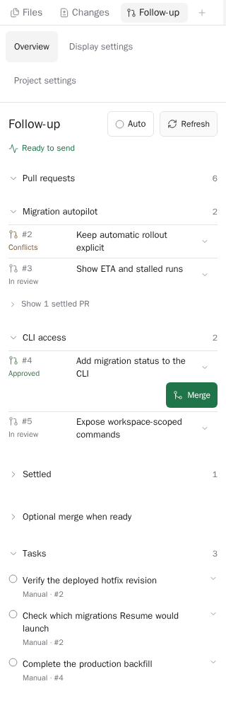
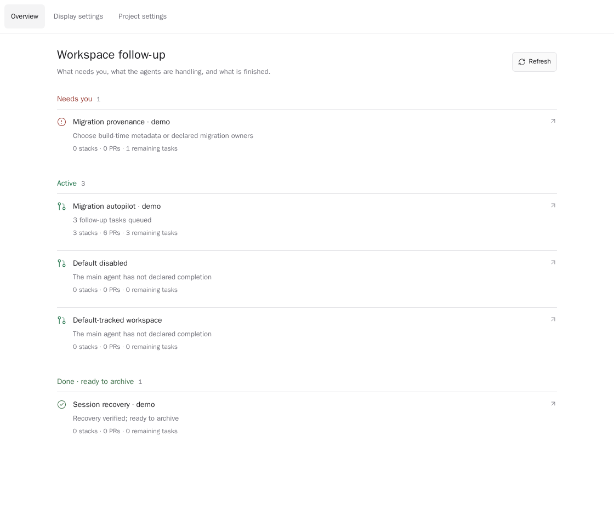

# Paseo Follow-up

[](https://www.npmjs.com/package/paseo-follow-up)
[](https://www.npmjs.com/package/paseo-follow-up)
[](https://paseo.sh)
[](LICENSE)

Keep long-lived Paseo workspaces moving through review, deployment, and completion. Follow-up retains PR stacks and remaining tasks, batches repairs for the existing main agent, and records the agent's explicit Done declaration.



Screenshots use synthetic workspaces and PRs.

## Requirements

- Paseo 0.14.0 or newer and Node 22 or newer.
- Authenticated GitHub CLI (`gh`) on the daemon host.
- Saved Graphite CLI authentication for Graphite readiness and explicit Merge controls.
- Optional Send to Paseo browser companion for Graphite's actual Merge when ready switch. Core tracking and follow-up work without it.

## Install

```sh
paseo plugin install paseo-follow-up
```

The installation ID remains `follow-through` to preserve existing development installations, saved settings and tracked work. The public name is **Follow-up**.

## Use

Open **Follow-up** from the sidebar or Command-K. In a workspace, use the header button or the Follow-up panel and click **Track this workspace**. The original main agent owns PRs, tasks and completion; optional history recovery runs in a separate agent only after your click.

Use **Overview**, **Project settings** and **Display settings** to move between views. Settings are also available directly from Command-K. Display settings can hide the workspace header button or sidebar entry independently; Command-K remains available.

Project settings control existing and future eligible workspaces by stable project ID. The retained development default enables canonical Git projects named `hero-poc`; other projects start off. Turning a project off stops enrollment while preserving tracked records. New enrollments always have Auto off.

With **Auto** off, review and send each repair batch yourself. Auto authorizes follow-up messages only for that workspace after fresh idle, permission and Session Guard checks. It never merges PRs, enables merge when ready, requests reviewers, starts recovery or archives workspaces.

Tasks default to manual. Explicit Now, After merge or After deploy triggers can include a delay; deployment tasks wait for verified serving-revision evidence. Merged PRs alone do not mean the work is Done. Agents retain evidence and record sent reply URLs for developer-authorized stakeholder updates.



## Data and permissions

This is a trusted, unsandboxed plugin. It reads selected workspace metadata, agent history/configuration and GitHub PR status using your existing host credentials. Local state and private recovery evidence live under `$PASEO_HOME/plugin-data/follow-through`; credentials and provider configuration are not published or transferred.

It registers scoped Claude/Codex MCP tools and reversible provider hooks for tracked main agents. Codex keeps its normal hook trust review. Repair and recovery prompts reach your configured agent provider. Follow-up itself has no Slack posting identity and never scans channels or authorizes replies from historical mentions.

Human-operated Merge and reviewer controls perform GitHub/Graphite writes only after an explicit click and fresh eligibility checks. Unknown or uncertain results require checking before retrying. Site-specific reviewer and Cloud Run deployment adapters remain limited to their configured repository; other deployment status remains unknown rather than being inferred from a merge.

## Develop

```sh
npm ci
npm run verify
npm run test:install
npm pack --dry-run
```

Integration checks use a separate Paseo home, synthetic agents and fixtures. Never restart your main daemon for verification. Reload only this plugin with `paseo plugin reload follow-through`.

## Releases

Release tags (`vX.Y.Z`) run `.github/workflows/publish-npm.yml`. GitHub Actions verifies the plugin and packed installation, publishes through npm Trusted Publishing, verifies registry integrity, then creates the GitHub release. No npm token is stored in repository secrets.

## Paseo 0.14 agent integration

The Follow-up MCP attaches when a tracked main or active recovery agent opens a Claude or Codex session. Normal startup no longer writes global Claude/Codex MCP settings. Existing global entries are preserved. Turn-ended discovery now fetches recent history through the SDK because Paseo 0.13+ sends an empty timeline in lifecycle events.

Requires Paseo **0.14.0 or newer**. Agent tools are scoped to interactive Claude
and Codex sessions; history-only opens receive none. They become available on
the next idle session open after install or reload. The agent label
`plugin-tools/enabled: "false"` opts a session out. Existing plugin data and
settings are retained.

## Other plugins

Also available from [Tom Gringauz](https://github.com/tomgrin10):

- [Defer](https://github.com/tomgrin10/paseo-defer) — Schedule messages to agents for later delivery.
- [Graphite](https://github.com/tomgrin10/paseo-graphite) — Workspace stack status and PR action radar.
- [Send to Paseo](https://github.com/tomgrin10/send-to-paseo) — Send GitHub and Graphite PRs to Paseo from Chrome.
- [Smart Session](https://github.com/tomgrin10/paseo-smart-session) — Context-aware compaction and plan usage insights.
- [Vitals](https://github.com/tomgrin10/paseo-vitals) — Host, Paseo, agent and Docker health.
- [Session Guard](https://github.com/tomgrin10/paseo-session-guard) — Pause at usage limits and resume after reset.
- [Transfer](https://github.com/tomgrin10/paseo-transfer) — Copy or move workspaces and agent conversations between hosts.
- [Transcript Search](https://github.com/tomgrin10/paseo-transcript-search) — Search active and archived conversations across hosts.
