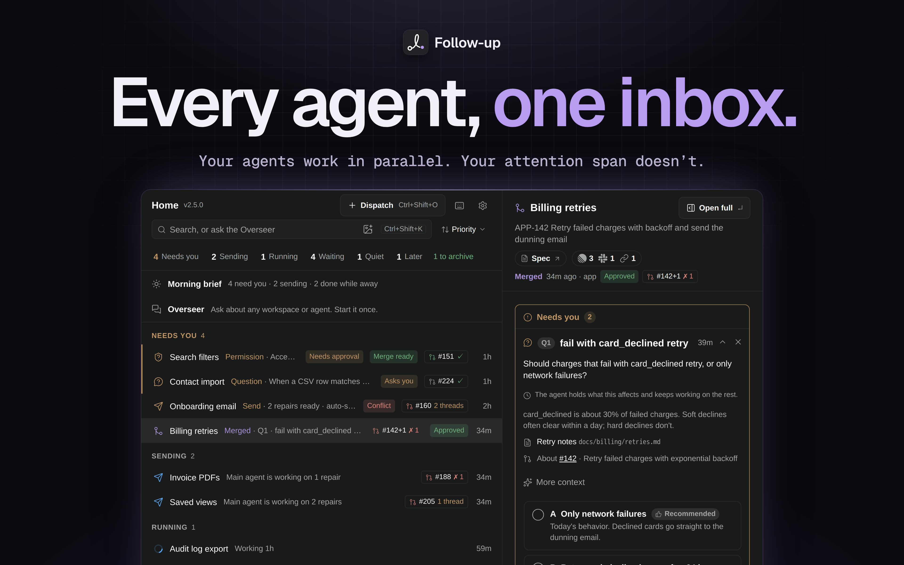

# Follow-up

[](https://www.npmjs.com/package/paseo-follow-up)
[](https://paseo.sh)
[](LICENSE)

**Every agent, one inbox.**

Your agents work in parallel. Your attention span doesn't. Agent tools, Paseo included, are organised around chats:
you visit each one to find out whether it needs you. Follow-up is a [Paseo](https://paseo.sh) plugin organised around
your attention instead. The work comes to you, in one place, ranked.



[](https://cdn.jsdelivr.net/gh/tomgrin10/paseo-follow-up@635e600d3390e23ea786492780755afda591bb45/docs/screenshots/follow-up-demo-v2.mp4)

36 seconds: Home, Catch up, automatic follow-ups, the Overseer.

## Install

```sh
paseo plugin install npm:paseo-follow-up
```

You need Paseo 0.15 or later and Node 22+ on the machine Paseo runs on; a signed-in GitHub CLI (`gh`) there is optional and turns on PR tracking. Then open
Follow-up in Paseo's sidebar. A two-minute setup walks you through the rest.

## What it does

### Every workspace in one place

All your workspaces, across every project, on one screen. Each shows its state, a one-line summary, and the Linear
issues, Slack threads and docs it's about. It's on Home, or always open as Paseo's sidebar.

<picture>
  <source media="(prefers-color-scheme: dark)" srcset="https://raw.githubusercontent.com/tomgrin10/paseo-follow-up/main/docs/screenshots/follow-up-frame-sidebar-dark.png">
  
</picture>

### Automatic follow-ups, through merge, deploy and after

Before the merge, failed checks, merge conflicts and review comments go back to the agent that made the PR by
themselves. After it, the tasks an agent recorded come due when the PR merges, when it's deployed, or a set number of
days later, and go back to the agent that owns them: verify it in production, reply in the Slack thread once it's
live, check the numbers again next week. Work isn't done when the agent stops, or even when the PR merges. Merging
and answering stay yours: see [what it never does on its own](#what-it-never-does-on-its-own).

<picture>
  <source media="(prefers-color-scheme: dark)" srcset="https://raw.githubusercontent.com/tomgrin10/paseo-follow-up/main/docs/screenshots/follow-up-frame-deploy-dark.png">
  
</picture>

### One inbox of what needs you, ranked by AI

Questions, failed checks, reviews and merges from every workspace, in one list. AI orders it by what your Linear
issues, Slack mentions and review requests say matters most. Agents ask for decisions as cards with lettered options
and a recommendation, so you answer in seconds without opening the chat or loading its context.

<picture>
  <source media="(prefers-color-scheme: dark)" srcset="https://raw.githubusercontent.com/tomgrin10/paseo-follow-up/main/docs/screenshots/follow-up-frame-home-dark.png">
  
</picture>

### An Overseer that knows all of it

One agent with every workspace's context. Ask it anything from Home's search box, like "what's blocked on review?",
and it answers or passes your words to the agent doing the work. It can re-rank the inbox too.

<picture>
  <source media="(prefers-color-scheme: dark)" srcset="https://raw.githubusercontent.com/tomgrin10/paseo-follow-up/main/docs/screenshots/follow-up-frame-overseer-dark.png">
  
</picture>

### Catch up

After a meeting or a morning away, go through everything that needs you one card at a time: answer, next, answer,
next. On the desktop or your phone.

<picture>
  <source media="(prefers-color-scheme: dark)" srcset="https://raw.githubusercontent.com/tomgrin10/paseo-follow-up/main/docs/screenshots/follow-up-catch-up-phone-dark.png">
  
</picture>

## Built with itself

Follow-up is built with Follow-up. Its repository went from a first commit on 2026-10-23 to 300 merged pull
requests a month later, almost all of them made by agents working in parallel.

I built it for myself, to keep up with my own agents, and it made me a lot more efficient.

## What it never does on its own

- Merge, request reviewers or archive. Those take your click, or an agent's plan that you confirmed.
- Answer a question for you.
- Wake a resting agent. It reads the transcript on disk instead.

It runs on your machine with your own GitHub sign-in. [Data and access](docs/data-access.md) says exactly what it reads and
writes.

## On the pull request, too

Add the [Send to Paseo](https://chromewebstore.google.com/detail/send-to-paseo/blflbbgkckbabbkoigpocilbkkmfijfg)
Chrome extension and a pull request on GitHub or Graphite shows the workspace that owns it and what it needs, like
"Needs you · Merge ready". **Open** jumps to its agent in Paseo, or send that agent an instruction from the same popup.
Follow-up can also switch Graphite's **Merge when ready** through it, after you confirm in Chrome.

<picture>
  <source media="(prefers-color-scheme: dark)" srcset="https://raw.githubusercontent.com/tomgrin10/paseo-follow-up/main/docs/screenshots/follow-up-send-to-paseo-dark.png">
  
</picture>

## Docs

- [Using Follow-up](docs/guide.md): setup, Home, Catch up, the Overseer, the panel, the pill, settings, helper agents,
  updates, reporting a bug, upgrading from 1.x and memory on Linux.
- [CHANGELOG.md](CHANGELOG.md): release notes.
- [AGENTS.md](AGENTS.md): how it's built and how to work on it.

Questions or bugs: ask any agent in Paseo to "report a bug about Follow-up", or
[open an issue](https://github.com/tomgrin10/paseo-follow-up/issues/new/choose).

## Credits

Ideas borrowed, with thanks, from [Progress](https://github.com/stevecastaneda/paseo-plugins/tree/main/progress) by
Steve Castaneda (questions with lettered options; MIT, see [THIRD_PARTY_NOTICES.md](THIRD_PARTY_NOTICES.md)) and
[Better Paseo](https://github.com/RoundRedDot/better-paseo) by RoundRedDot (the grouped Home list).

## Other plugins

[Defer](https://github.com/tomgrin10/paseo-defer),
[Send to Paseo](https://github.com/tomgrin10/send-to-paseo),
[Session Guard](https://github.com/tomgrin10/paseo-session-guard),
[Smart Session](https://github.com/tomgrin10/paseo-smart-session),
[Transcript Search](https://github.com/tomgrin10/paseo-transcript-search),
[Transfer](https://github.com/tomgrin10/paseo-transfer),
[Vitals](https://github.com/tomgrin10/paseo-vitals) and
[Workspace Switcher](https://github.com/tomgrin10/paseo-switcher).

## License

[MIT](LICENSE) © 2026 Tom Gringauz.
