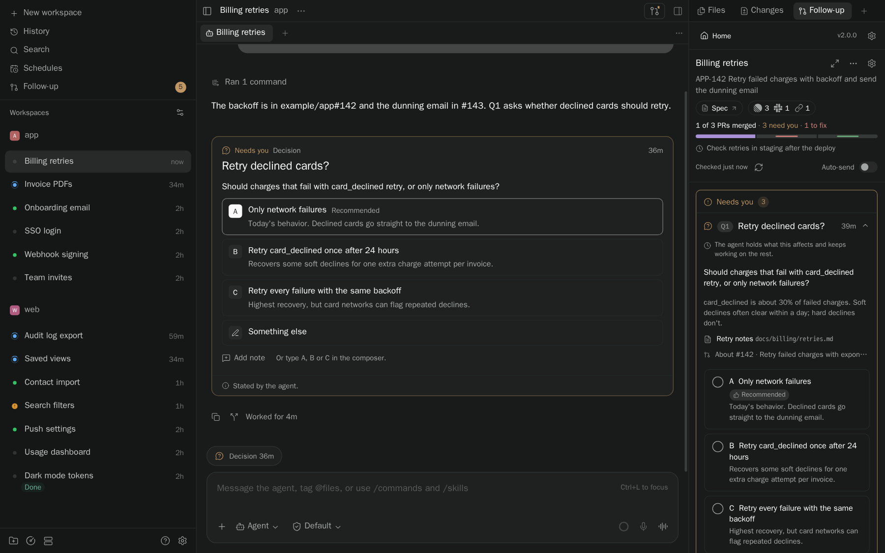
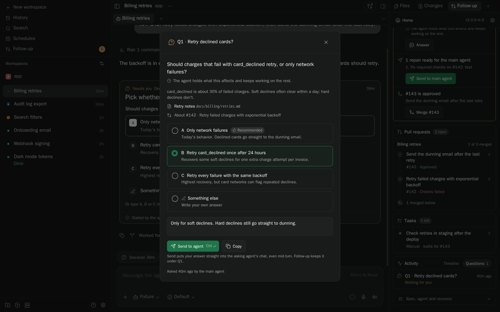
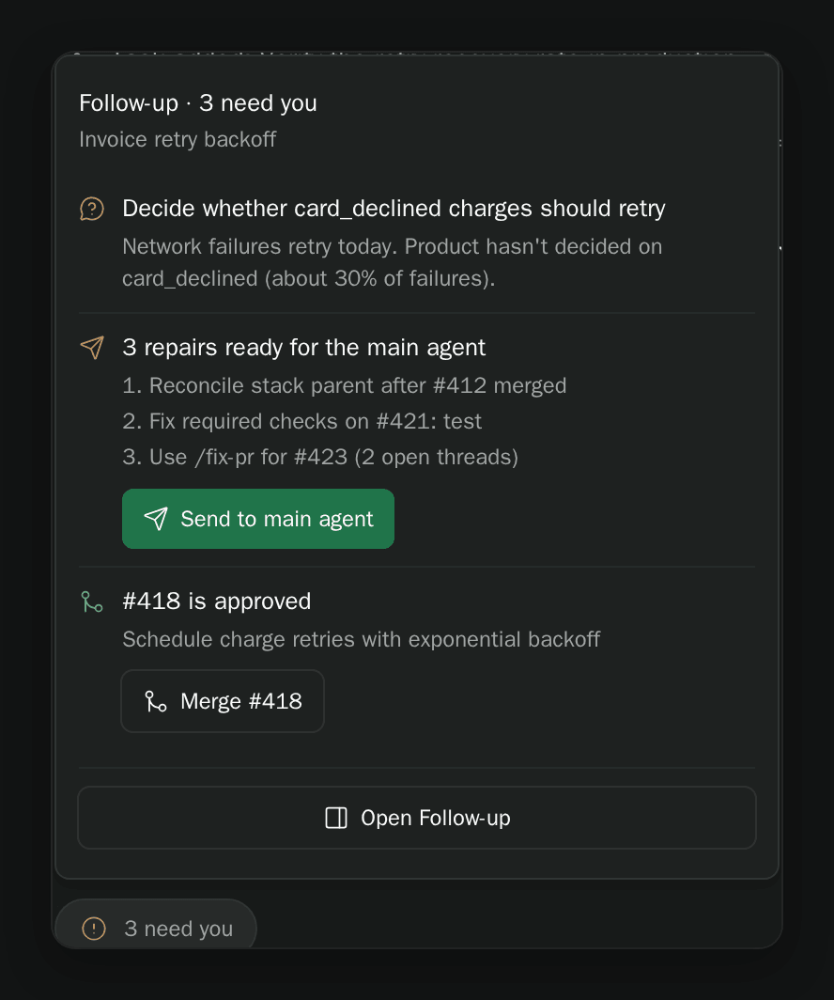
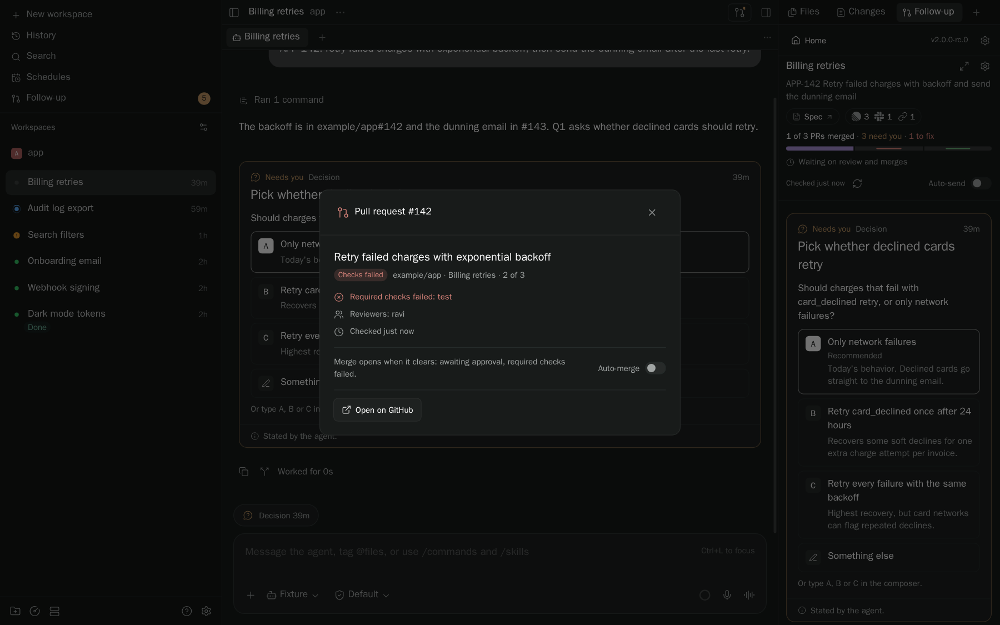
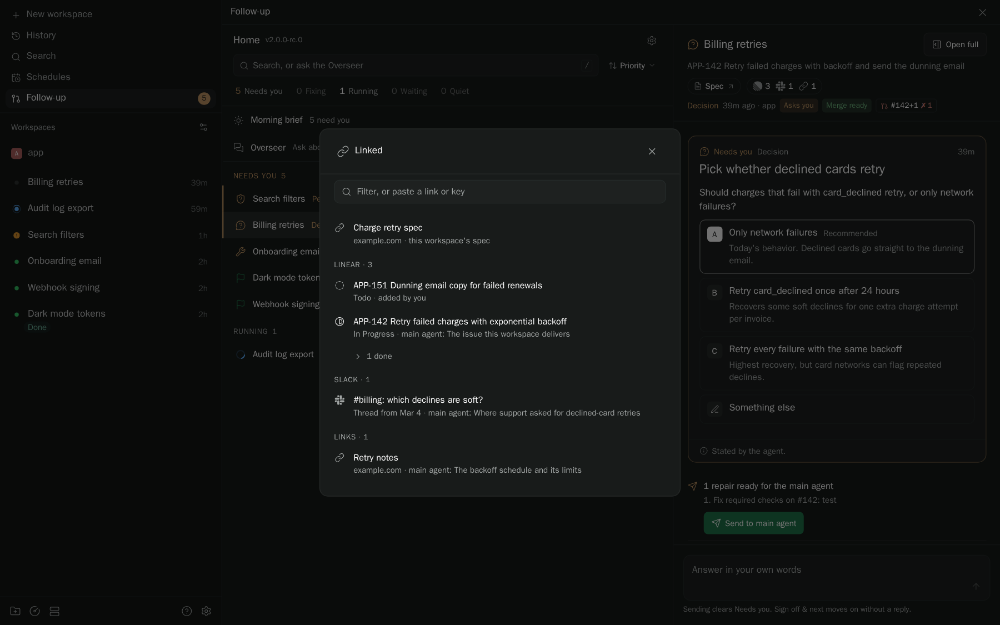

# Using Follow-up

The [README](../README.md) says what Follow-up is and how to install it. This page is the rest: setup, each part of
the app, settings, updates and a few things for specific setups. Screenshots use synthetic workspaces, people and PRs.

- [Setup](#setup)
- [Using it](#using-it)
- [Updates and What's new](#updates-and-whats-new)
- [Helper agents and providers](#helper-agents-and-providers)
- [Settings](#settings)
- [Report a bug or request a feature](#report-a-bug-or-request-a-feature)
- [Upgrading from 1.x](#upgrading-from-1x)
- [Data and access](#data-and-access)
- [Memory on Linux](#memory-on-linux)
- [Working on Follow-up](#working-on-follow-up)

## Setup

The first time Follow-up loads, setup opens as a popup: a welcome page with what Follow-up does and **Set up
Follow-up**, then a few steps, then a done page. It takes about two minutes, and **Skip setup** leaves it at any point.
Close (X) puts it away without losing your place: Home shows **Finish setup**, which opens it again on the same step.


It shows what Follow-up does, checks the helper agents and GitHub (with the fix to copy for anything missing), and asks
what Follow-up may do without asking you, how you ship PRs, who reviews, how it updates and which helpers to turn on.
Every switch is the same one Settings shows. Run it again from Settings → General → **Set up Follow-up again**.

GitHub is optional. Without the GitHub CLI (`gh`), or with it signed out, setup lists GitHub as optional with a link to
install it and `gh auth login` to copy, and everything that isn't about GitHub works: workspaces, Needs you, questions,
briefs, Catch up, the Overseer, tasks and Compass. What GitHub adds (PR status, repairs from review threads and failed
checks, Merge, reviewers, Wait for checks, deploy checks and PR stats) each says in one line what's missing and how to
turn it on, and Follow-up makes no GitHub request meanwhile. Install `gh` and sign in on the computer running Paseo
whenever you like; Follow-up notices within a minute, no restart.

## Using it

Open **Follow-up** in Paseo's sidebar for Home, or the Follow-up icon in a workspace's header for that workspace's
panel. ⌘K (Ctrl+K) has a Follow-up command for most things.

Home lists every workspace, grouped by what it needs from you. When an agent finishes, asks something, hits an error
or waits for a permission, it moves to the top, under **Needs you**, and stays there until you mark it done or reply.
You act on it right there, without opening the chat.

Each running workspace's row, and the top of its panel, says what each agent is working on and what it's doing now:
"Capping the retry gap 2/4 · working 6m". Agents say what they're working on, with the steps before and after it, when
they sync with Follow-up; until one does, the line shows only what it's doing (working, waiting on your OK, waiting on
CI, idle). It never shows tool calls or files, and it costs no AI.

When a PR's checks fail, it hits a merge conflict or a reviewer leaves comments, Follow-up sends them to the agent
that made the PR, in one message once it's idle. You're only asked for what's yours to decide, like merging. Works
with plain GitHub; Graphite is optional.

Type in Home's search box and an agent that knows all your workspaces passes your question to the one doing the work.
Optionally, Follow-up orders the list by what your Linear issues, Slack mentions and review requests say matters most.

On Paseo 0.16 or newer, Follow-up can also be your sidebar: pick **Follow-up: Needs you** in Settings → Sidebar →
View. Follow-up 2.0 still runs on Paseo 0.15; there it simply doesn't offer the view.

On Paseo 0.17.1 or newer, a finished workspace's row in Paseo's own sidebar carries a green **Done** badge. Turn it
off with **Follow-up: Done** in the sidebar's Show menu. Older Paseo versions get a Done label on the row instead.




### Answer a question

When an agent needs a decision, it asks in a card with lettered options, its recommendation and room for your own
answer. Answer on Home, in the workspace's side panel, in the bar above the agent's message box, or on your phone. The
answer goes straight into the agent's chat.

Pick an option, add a note if you like, and send. Cmd+Enter (Ctrl+Enter) sends. If the agent is busy or waking up,
the card says Sending until it has the answer, and offers Send again if it couldn't deliver.



### Catch up

**Catch up** on Home goes through everything that needs you one card at a time: answer, merge or sign off, and the
next card comes up. Skip moves a card to the end, Later snoozes it, and More context asks the agent to explain before
you decide, while the deck moves on. On desktop the keys do it all (S lists them); on a phone the moves sit under the
card.

<picture>
  <source media="(prefers-color-scheme: dark)" srcset="screenshots/follow-up-catch-up-phone-dark.png">
  
</picture>

### The Overseer

The Overseer is one agent that knows every workspace. Click **Start the Overseer** on Home once. Then type in Home's
search box and pick **Ask the Overseer**: it answers from what Follow-up knows, or passes your words to the agent that
owns the work, and says where it sent them. It never merges, approves, archives or posts anywhere, and it starts a new
workspace only when you ask.

### The pill

The bar above the message box (the pill) shows what needs you in the chat you're in, with the same actions.



### A PR

Tap a PR (on desktop, its segment in the stack bar too) for its checks, reviewers and Merge. When Merge isn't available yet, the
sheet says what it's waiting for. Follow-up never merges on its own, and Merge checks the stack again first.



### Summary and linked items

Each workspace gets a one-line Summary of what it's for. Next to it: the Linear issues, Slack threads and docs it's
about, with who linked each one and why. Paste a link or a key to add one. Agents link what they start from, and a
Linear key counts only once Linear confirms it.



### On a phone

Home is the list and a row opens its detail. Sheets open from the bottom.


### What it never does on its own

- Merge, turn on merge when ready, request reviewers or archive. Those take your click, or an agent's confirmed plan.
- Answer a question for you. Answers go out only when you send them.
- Wake an agent that's resting to read it. It reads the transcript on disk instead.

Your agents can do anything you can click in Follow-up, after showing you a plan.

## Updates and What's new

Follow-up updates itself when nothing is busy, and rolls back if an update fails. With Updates set to **Tell me**,
Home says when any newer stable version is available, including minor and patch releases. On the Beta channel, betas
show only in Settings → General.

After an update that brings new release notes, Follow-up shows **What's new** once: every version's changes in one
scroll, newest first, each with its date and an **Installed** tag on the one you run. Scroll down for older versions;
the open-in-browser icon shows each version's full changelog on GitHub. Betas install quietly and don't appear there.
To stop it, turn off **Show What's new after updates** in Settings → General. Release notes are there too, and in
[CHANGELOG.md](../CHANGELOG.md).

Betas are on npm's `beta` dist-tag: `paseo plugin install npm:paseo-follow-up@beta`.

## Helper agents and providers

Follow-up runs a few small background jobs ("helpers") for you. Each one is optional, and Settings → **Agents** shows
what each uses and recommends a model from the providers you have, with **Use recommended** in one click.

| Helper | What it does | Runs on |
| --- | --- | --- |
| Summaries | One sentence under each workspace's title saying what it's for | Any provider Paseo has |
| AI priority | Sorts Home from Linear, Slack and review requests, about hourly on workdays, and only when something changed | Any provider Paseo has |
| Overseer | One agent you ask about all your workspaces. Starts only when you click Start on Home | A Paseo agent, Claude by default |
| Recovery | Rebuilds a workspace's tracking when Follow-up lost track of it. Runs only when you ask | The main agent's provider, or one you pick |

Claude, Codex and Pi run a job directly. Other providers run it as a short hidden agent. A job that reads other
people's words (AI priority, Compass, Ask, Summaries' linked items) runs only where it can have no tools at all:
Claude, Codex, Pi, or OpenCode with every tool denied. AI priority reads Linear and Slack through read-only tools and
never posts anything.

## Settings

Settings (the gear on Home, or ⌘K → **Follow-up: settings**) has seven categories:

- General: updates (Install automatically, Tell me or Off; Stable or Beta), setup, and the release notes.
- Following: which projects and workspaces Follow-up follows, auto-send, how each repository ships PRs (GitHub or
  Graphite, the merge method, how agents handle review comments), and Trust bypass for permission prompts.
- Reviewers: who **Add reviewers** asks, with a default for every repository and a list per repository.
- Agents: the helper agents and their models (Dispatch is the role that starts Dispatch's work), what agents do while a question
  waits, and, on Paseo 0.15, Wait for background jobs.
- Dispatch: Dispatch in the sidebar, the actions it offers (order, show or hide, reset to built-in), which project each Linear team's work
  goes to, and the base branch per project.
- Inbox & display: the Needs-you inbox, the sidebar badge, the pills and the Dispatch-from-anywhere key.
- Morning brief: this week's plan, its sources and the Linear queue.

## Report a bug or request a feature

Ask any agent in Paseo to "report a bug about Follow-up" (or a feature request, or feedback), or use **Report a bug**
in Settings → General, Command-K, `/report-issue` in the composer, or **Report this** on any error. The agent asks what
it needs, checks what it can, and shows you the exact issue before filing it in this repository with your own GitHub
sign-in. It adds Follow-up's version, Paseo's, your OS and recent errors, and replaces private repository names, PR
titles, hostnames, emails and paths with placeholders. Screenshots are uploaded to a public `paseo-issue-assets`
repository in your account only if you say yes for that report; otherwise you drag them into the issue. Without a
GitHub sign-in you get a prefilled link instead. You can also
[open an issue](https://github.com/tomgrin10/paseo-follow-up/issues/new/choose) by hand.

## Upgrading from 1.x

Update as usual. 2.0 copies your data to its new folder and moves itself to the plugin id `follow-up` once, while
nothing is busy; Settings → General says when it's done. 2.0 needs Paseo 0.15 or later. To go back to 1.0.1:

```sh
paseo plugin remove follow-up
paseo plugin install npm:paseo-follow-up@1.0.1
```

1.x's data folder is never deleted, so 1.0.1 starts from where it was before the move.

## Data and access

Paseo plugins run trusted, unsandboxed code on the daemon's machine. Follow-up reads workspace metadata, agent history
and GitHub PR status with your existing credentials, and keeps its state in `$PASEO_HOME/plugin-data/follow-up`. It
gives agents scoped tools and installs reversible hooks for Claude Code and Codex. Agents on any other provider
Paseo runs get every feature: the tools, the instructions (in their system prompt on Paseo 0.17, or through a tool on
ACP agents), the turn-end reminders as a message and Wait; see
[hooks.md](hooks.md#other-providers). [data-access.md](data-access.md) has
the full data-access statement.

## Memory on Linux

On Linux (glibc), a Follow-up that stays up for hours can slowly grow in memory: the allocator keeps memory Follow-up
already freed. macOS isn't affected. Three allocator settings in the Paseo daemon's environment stop most of the idle
growth. Every process Paseo starts inherits them.

If a systemd unit runs Paseo, add them to it (the unit name is your own; `paseo` here):

```sh
systemctl --user edit paseo
```

```ini
[Service]
Environment=MALLOC_ARENA_MAX=2 MALLOC_MMAP_THRESHOLD_=131072 MALLOC_TRIM_THRESHOLD_=131072
```

Then `systemctl --user restart paseo`. If the unit already reads an `EnvironmentFile=` (say `~/.config/paseo/env`),
put the three `NAME=value` lines there instead. If you start the daemon from a shell, stop it and start it with them:

```sh
paseo daemon stop
MALLOC_ARENA_MAX=2 MALLOC_MMAP_THRESHOLD_=131072 MALLOC_TRIM_THRESHOLD_=131072 paseo daemon start
```

In our test harness (140 workspaces, 45 idle minutes) Follow-up grew about 20 MB without them and 3 to 6 MB with them,
at no measurable CPU cost. On a busy real setup they kept Follow-up flat while idle, but memory still stepped up during
bursts of activity and stayed there: after about 4.7 hours it used 363 MB with them and 375 MB without. To undo it,
remove the settings and restart Paseo.

## Working on Follow-up

```sh
npm ci
npm run verify
npm run test:install
npm run shots          # re-shoots the README images in an isolated daemon
```

Checks run against a separate Paseo home with synthetic agents, never your own. A PR that changes something users see
adds a release-note fragment ([rules](../changes/README.md)), and releases are described in
[releasing.md](releasing.md). [AGENTS.md](../AGENTS.md) is the place to start, with or without an agent: the
architecture, invariants and how to test. Each part has its own page here, such as [Needs you](needs-you.md),
[PRs](prs.md), [Linked items](linked-items.md), [updates](updates.md), [Wait](wait.md) and
[agent tools](rpcs-and-tools.md).
